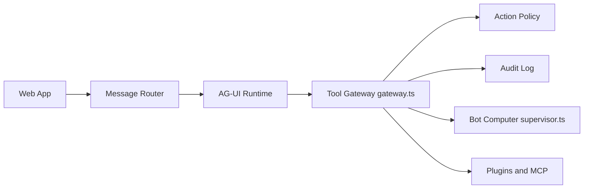

# CopilotKit/OpenBot

> Self-hosted enterprise assistant template: AG-UI agents with their own browser, action policy and audit.

## The problem
Letting an agent use tools and a browser connected to real accounts without being able to decide or trace what it does.

## What it actually does
A ChatGPT-style chat interface where each "colleague" is an AG-UI endpoint (LangGraph, Mastra, CrewAI, hand-written). Every action on browser, file, MCP or component goes through a single gateway: CEL policy (deny takes priority, fail closed), audit line written before the call, human takeover possible. Docker Compose launches the app, the Hono API, the Chromium computers and PostgreSQL; routines and SSO (Google, Microsoft, Okta, SAML/OIDC) are included. The README says "a template, not a product".

## How it is wired


## Trying it
```bash
cp .env.example .env
bun install
npx --yes copilotkit@latest login
npx --yes copilotkit@latest project select
bun scripts/setup-learning.ts
bash scripts/start.sh
```

## Cost and gotchas
You need Docker, Bun 1.4+, a model key and a CopilotKit Intelligence project (free tier, self-hostable) for threads and memory. `OPENBOT_SINGLE_USER=true` by default admits everyone as administrator: remove it before any sharing. Beta.

## What it is not
Not a hosted product nor an installable package: you clone and adapt. Not independent of CopilotKit Intelligence. No model provided.

## Alternatives
- No alternative named in the README.

## For you
Watch: the policy and audit gateway is a good reference for governing agents, but the project is young (created in August 2026) and tied to Intelligence; clone it for inspiration rather than to deploy.
