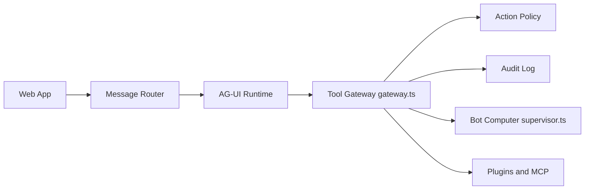

# CopilotKit/OpenBot

> Gabarit d'assistant d'entreprise auto-hébergé : des agents AG-UI avec navigateur propre, politique d'actions et audit.

## Le problème
Laisser un agent utiliser des outils et un navigateur connectés à des comptes réels sans pouvoir décider ni tracer ce qu'il fait.

## Ce que ça fait vraiment
Une interface de chat type ChatGPT où chaque « collègue » est un endpoint AG-UI (LangGraph, Mastra, CrewAI, à la main). Chaque action sur navigateur, fichier, MCP ou composant passe par une passerelle unique : politique CEL (refus prioritaire, échec fermé), ligne d'audit écrite avant l'appel, prise en main humaine possible. Docker Compose lance l'app, l'API Hono, les ordinateurs Chromium et PostgreSQL ; les routines, le SSO (Google, Microsoft, Okta, SAML/OIDC) sont inclus. Le README dit « un gabarit, pas un produit ».

## Comment c'est branché


## Essayer
```bash
cp .env.example .env
bun install
npx --yes copilotkit@latest login
npx --yes copilotkit@latest project select
bun scripts/setup-learning.ts
bash scripts/start.sh
```

## Coût et pièges
Il faut Docker, Bun 1.4+, une clé de modèle et un projet CopilotKit Intelligence (offre gratuite, auto-hébergeable) pour les fils et la mémoire. `OPENBOT_SINGLE_USER=true` par défaut admet tout le monde en administrateur : à retirer avant tout partage. Bêta.

## Ce que ce n'est pas
Pas un produit hébergé ni un paquet installable : on clone et on adapte. Pas indépendant de CopilotKit Intelligence. Aucun modèle fourni.

## Alternatives
- Aucune alternative nommée dans le README.

## Pour toi
À surveiller : la passerelle de politique et d'audit est une bonne référence pour gouverner des agents, mais le projet est jeune (créé en août 2026) et lié à Intelligence ; à cloner pour s'en inspirer plutôt que pour déployer.

