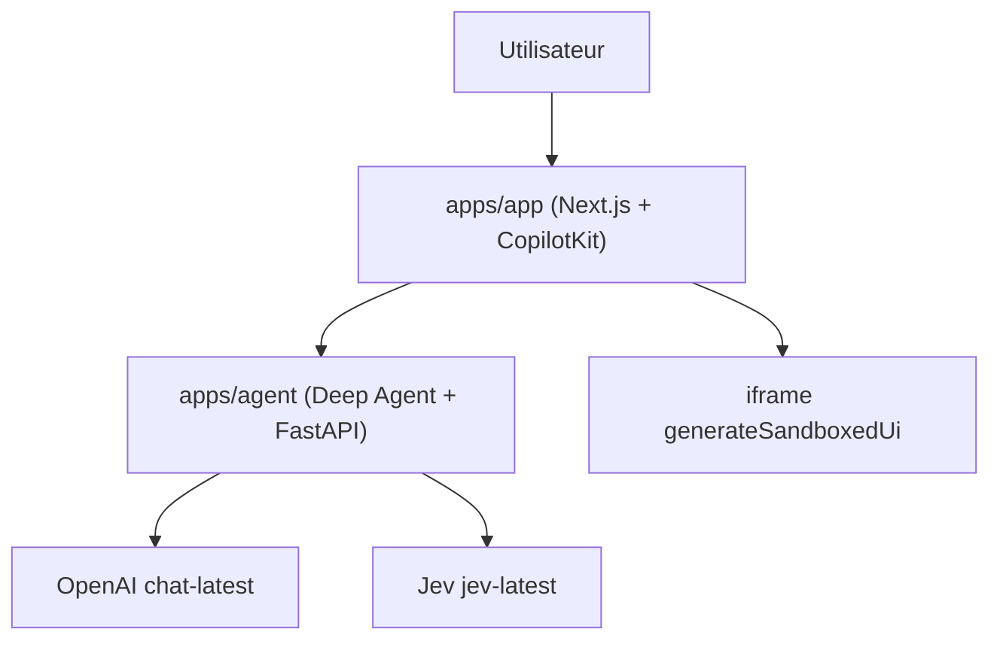

# CopilotKit/OpenIntelligentUI

> Free-form chat interface that replies with text, components or generated interactive mini-tools.

## The problem
Classic chats answer in text; comparing, simulating or calculating requires separate tools.

## What it actually does
A Python agent (Deep Agent, FastAPI) chooses between text, a native component or a generated interface. Tables go through A2UI; charts, calculators and maps go through Open Generative UI, in an isolated iframe. A Next.js frontend with CopilotKit relays the stream. A standalone MCP server is optional. The default model is OpenAI's chat-latest, with the Jev router.

## How it is wired
Simplified diagram based on the sheet, no diagram provided.


## Trying it
```bash
git clone https://github.com/CopilotKit/OpenIntelligentUI.git
cd OpenIntelligentUI
make setup
make dev
```

## Cost and gotchas
Two paid API keys: OPENAI_API_KEY and TYPESAFE_API_KEY. You need Node 22+, pnpm 9+, Python 3.12+ and uv. Maps require network access. A README page covers telemetry and how to disable it.

## What it is not
It is not a local chat: requests go through OpenAI and Jev. The figures in the examples are illustrations. Outputs vary from one run to the next.

## Alternatives
No alternative named in the README.

## For you
Keep an eye on it: shows a good generative-interface pattern with an isolated iframe, but depends on two paid providers.
