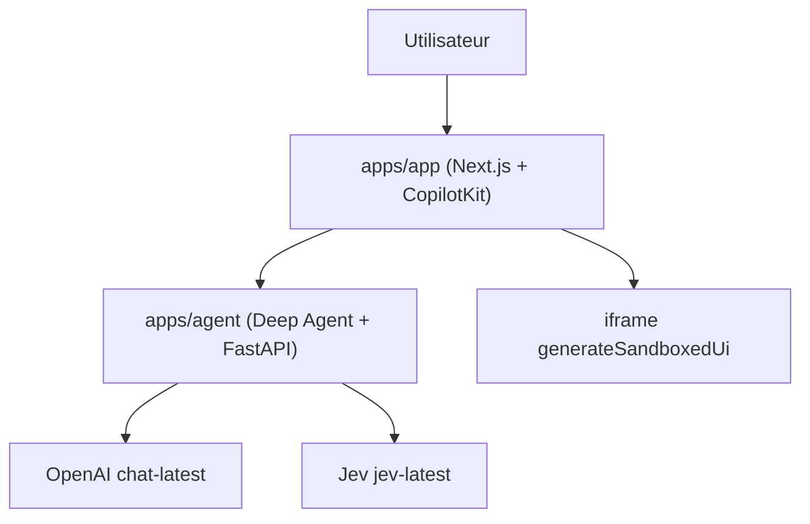

# CopilotKit/OpenIntelligentUI

> Interface de chat libre qui répond par du texte, des composants ou des mini-outils interactifs générés.

## Le problème
Les chats classiques répondent en texte ; comparer, simuler ou calculer demande des outils à part.

## Ce que ça fait vraiment
Un agent Python (Deep Agent, FastAPI) choisit entre texte, composant natif ou interface générée. Les tableaux passent par A2UI ; graphiques, calculatrices et cartes par Open Generative UI, dans une iframe isolée. Un frontend Next.js avec CopilotKit relaie le flux. Un serveur MCP autonome est optionnel. Le modèle par défaut est chat-latest d'OpenAI, avec le routeur Jev.

## Comment c'est branché
Schéma simplifié d'après la fiche, sans diagramme fourni.


## Essayer
```bash
git clone https://github.com/CopilotKit/OpenIntelligentUI.git
cd OpenIntelligentUI
make setup
make dev
```

## Coût et pièges
Deux clés d'API payantes : OPENAI_API_KEY et TYPESAFE_API_KEY. Il faut Node 22+, pnpm 9+, Python 3.12+ et uv. Les cartes demandent un accès réseau. Une page du README traite de la télémétrie et de sa désactivation.

## Ce que ce n'est pas
Ce n'est pas un chat local : les requêtes passent par OpenAI et Jev. Les exemples chiffrés sont des illustrations. Les sorties varient d'une exécution à l'autre.

## Alternatives
Aucune alternative nommée dans le README.

## Pour toi
Surveiller : montre un bon patron d'interface générative avec iframe isolée, mais dépend de deux fournisseurs payants.

