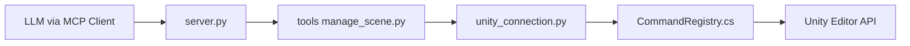

# CoplayDev/unity-mcp

> MCP bridge that lets an AI client drive the Unity editor in natural language.

## The problem
Creating scenes, scripts and assets in Unity by hand is repetitive, and an agent has no access to the editor.

## What it actually does
A Unity package (C#) and a Python server launched by `uv` relay MCP calls: 50 tool entries for scenes, GameObjects, C# scripts, assets, tests, profiling and build. Tool groups (VFX, animation, UI, tests), multi-instance routing and Roslyn validation. Compatible with Claude, Cursor, VS Code, Windsurf, Cline and Gemini CLI.

## How it is wired


## Trying it
```text
https://github.com/CoplayDev/unity-mcp.git?path=/MCPForUnity#main
```
In Unity: `Window → MCP for Unity → Configure All Detected Clients`, then ask "Create a cube at the origin and add a Rigidbody."

## Cost and gotchas
Unity 2021.3 LTS to 6.x and Python 3.10+ via `uv`. Free (MIT). The same publisher offers Aura for Unity, a separate premium product.

## What it is not
Not affiliated with Unity Technologies. The tools drive the local editor, not a server build.

## Alternatives
Godot AI, a new project by the same authors (mentioned).

## For you
Ignore: useful only for Unity development, unrelated to data/AI/MLOps.
