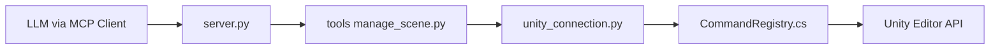

# CoplayDev/unity-mcp

> Pont MCP qui laisse un client IA piloter l'éditeur Unity en langage naturel.

## Le problème
Créer des scènes, scripts et assets dans Unity à la main est répétitif, et un agent n'a aucun accès à l'éditeur.

## Ce que ça fait vraiment
Un paquet Unity (C#) et un serveur Python lancé par `uv` relaient les appels MCP : 50 entrées d'outils pour scènes, GameObjects, scripts C#, assets, tests, profilage et build. Groupes d'outils (VFX, animation, UI, tests), routage multi-instances et validation Roslyn. Compatible avec Claude, Cursor, VS Code, Windsurf, Cline et Gemini CLI.

## Comment c'est branché


## Essayer
```text
https://github.com/CoplayDev/unity-mcp.git?path=/MCPForUnity#main
```
Dans Unity : `Window → MCP for Unity → Configure All Detected Clients`, puis demander « Create a cube at the origin and add a Rigidbody. »

## Coût et pièges
Unity 2021.3 LTS à 6.x et Python 3.10+ via `uv`. Gratuit (MIT). Le même éditeur propose Aura for Unity, produit premium distinct.

## Ce que ce n'est pas
Pas affilié à Unity Technologies. Les outils pilotent l'éditeur local, pas un build serveur.

## Alternatives
Godot AI, nouveau projet des mêmes auteurs (mentionné).

## Pour toi
À ignorer : utile seulement pour le développement Unity, sans rapport avec data/IA/MLOps.

