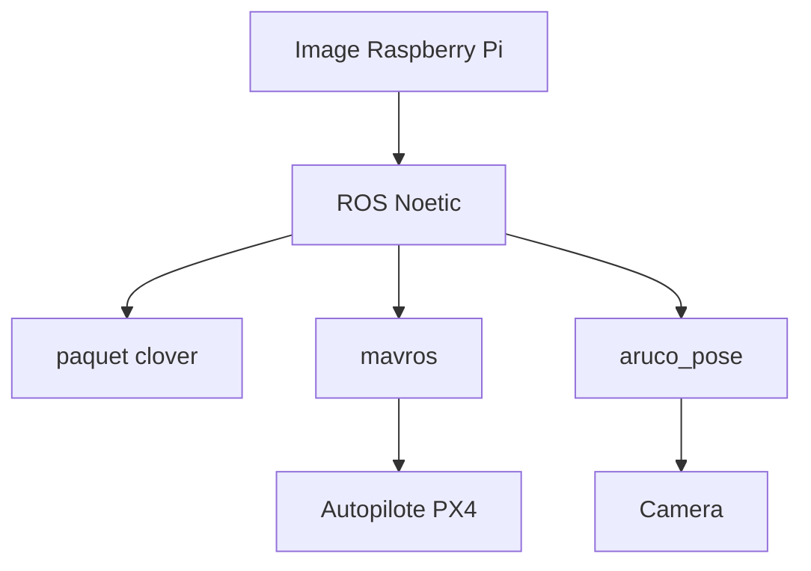

# CopterExpress/clover

> Open source ROS framework for piloting autonomous PX4 drones, delivered as a Raspberry Pi image for education.

## The problem
Programming an autonomous drone requires assembling ROS, MAVLink, vision and network settings, which takes a long time to set up.

## What it actually does
Provides a `clover` ROS package and a ready-to-fly Raspberry Pi image: Raspbian Buster, ROS Noetic, OpenCV, `mavros`, GPIO and LED drivers, and `aruco_pose` for marker-based navigation. Designed for the COEX Clover educational kit.

## How it is wired

Simplified diagram based on the fiche, no diagram provided.

## Trying it
No command in the README: flash the image from the Releases and follow the documentation at `https://clovercoex.tech`.

## Cost and gotchas
The COEX Clover hardware kit is sold separately. The image relies on old versions (Raspbian Buster, ROS Noetic).

## What it is not
Not consumer drone software nor a simulator. It assumes a PX4-compatible autopilot and a Raspberry Pi.

## Alternatives
No alternative cited in the README.

## For you
Ignore: a robotics domain far from a data, AI or MLOps profile, unless you have an onboard drone vision project.
