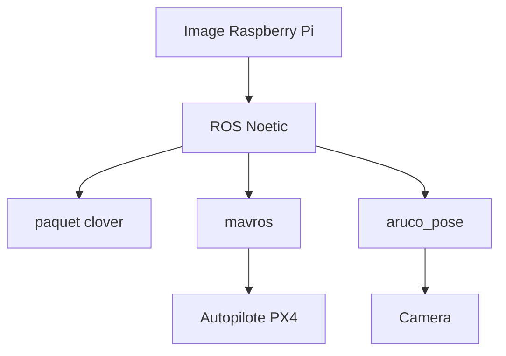

# CopterExpress/clover

> Cadre ROS open source pour piloter des drones PX4 autonomes, livré en image Raspberry Pi pour l'éducation.

## Le problème
Programmer un drone autonome demande d'assembler ROS, MAVLink, vision et réglages réseau, long à mettre en place.

## Ce que ça fait vraiment
Fournit un paquet ROS `clover` et une image Raspberry Pi prête à voler : Raspbian Buster, ROS Noetic, OpenCV, `mavros`, pilotes GPIO et LED, et `aruco_pose` pour la navigation par marqueurs. Pensé pour le kit pédagogique COEX Clover.

## Comment c'est branché

Schéma simplifié d'après la fiche, sans diagramme fourni.

## Essayer
Aucune commande dans le README : flasher l'image depuis les Releases et suivre la documentation sur `https://clovercoex.tech`.

## Coût et pièges
Le kit matériel COEX Clover est vendu séparément. L'image repose sur des versions anciennes (Raspbian Buster, ROS Noetic).

## Ce que ce n'est pas
Pas un logiciel de drone grand public ni un simulateur. Il suppose un autopilote compatible PX4 et un Raspberry Pi.

## Alternatives
Aucune alternative citée dans le README.

## Pour toi
À ignorer : domaine robotique éloigné d'un profil data, IA ou MLOps, sauf projet de vision embarquée sur drone.

