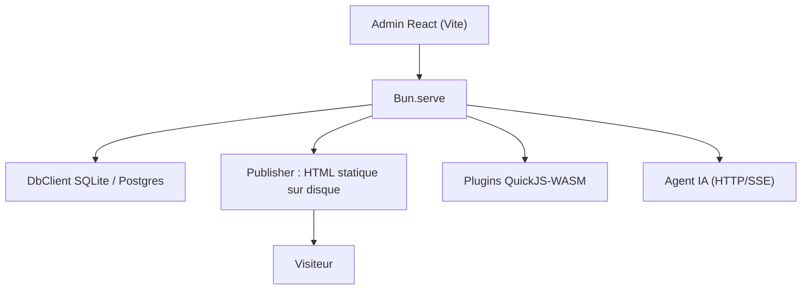

# CoreBunch/Instatic

> Self-hosted CMS on a Bun server, with a visual editor, AI agent and static HTML publishing.

## The problem
A modern site requires stacking a headless CMS, framework, host, forms and analytics, each with its own bill.

## What it actually does
A single Bun server carries the canvas editor, content model (`data_tables`, `data_rows`), media, auth, forms, plugins and publishing. Pages are published as compact HTML and CSS, written to disk. SQLite or Postgres database. An AI agent edits the canvas with the model of your choice (Claude, OpenAI, OpenRouter, Ollama). Plugins in a QuickJS-WASM sandbox.

## How it is wired


## Trying it
```sh
git clone https://github.com/corebunch/instatic.git
cd instatic
bun install
bun run dev
```
Docker: `INSTATIC_IMAGE=ghcr.io/corebunch/instatic:latest docker compose -f compose.prod.yml -f compose.sqlite.yml up -d`

## Cost and gotchas
Bun 1.4.1 or later required. The AI agent uses your own API key. Hosting is at your expense (Railway, Render, VPS).

## What it is not
Version 0.0.x: the README states that APIs may change before 1.0. No visitor analytics, only an operational dashboard.

## Alternatives
No alternative named in the README.

## For you
Ignore: it is a website CMS, outside the data/AI/MLOps scope, and still experimental.
