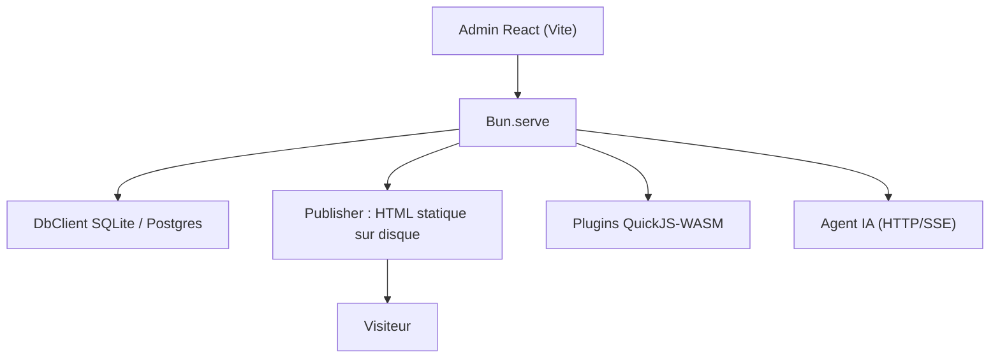

# CoreBunch/Instatic

> CMS auto-hébergé sur un serveur Bun, avec éditeur visuel, agent IA et publication en HTML statique.

## Le problème
Un site moderne demande d'empiler CMS headless, framework, hébergeur, formulaires et analytics, chacun avec sa facture.

## Ce que ça fait vraiment
Un seul serveur Bun porte éditeur canvas, modèle de contenu (`data_tables`, `data_rows`), médias, auth, formulaires, plugins et publication. Les pages sont publiées en HTML et CSS compacts, écrites sur disque. Base SQLite ou Postgres. Un agent IA édite le canvas avec le modèle de ton choix (Claude, OpenAI, OpenRouter, Ollama). Plugins dans un bac à sable QuickJS-WASM.

## Comment c'est branché


## Essayer
```sh
git clone https://github.com/corebunch/instatic.git
cd instatic
bun install
bun run dev
```
Docker : `INSTATIC_IMAGE=ghcr.io/corebunch/instatic:latest docker compose -f compose.prod.yml -f compose.sqlite.yml up -d`

## Coût et pièges
Bun 1.4.1 ou plus requis. L'agent IA utilise ta propre clé d'API. Hébergement à ta charge (Railway, Render, VPS).

## Ce que ce n'est pas
Version 0.0.x : le README annonce que les API peuvent changer avant la 1.0. Pas d'analytics visiteurs, seulement un tableau de bord opérationnel.

## Alternatives
Aucune alternative nommée dans le README.

## Pour toi
Ignorer : c'est un CMS de sites web, hors du périmètre data/IA/MLOps, et encore expérimental.

