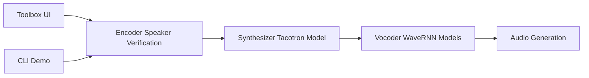

# CorentinJ/Real-Time-Voice-Cloning

> SV2TTS voice cloning implementation from a master's thesis, with a graphical toolbox.

## The problem
Generating a speaker's voice from a few seconds of audio, without retraining a model.

## What it actually does
Three stages: GE2E encoder (voice fingerprint), Tacotron synthesizer (text → spectrogram), WaveRNN vocoder (spectrogram → audio).
GUI toolbox and CLI demo; pre-trained models downloaded automatically.
Supported datasets, LibriSpeech train-clean-100 recommended.
The author himself writes that the repository has aged and that the quality is outdated.

## How it is wired


## Trying it
```bash
pip install -U uv
uv run --extra cuda demo_toolbox.py
uv run --extra cpu demo_cli.py
```

## Cost and gotchas
FFmpeg required; NVIDIA GPU optional. License present but not identified by GitHub.

## What it is not
Not state of the art: the author recommends other solutions. The provided diagram is generic (explanation, not a reading of the code).

## Alternatives
- Chatterbox: cited by the author as an up-to-date 2025 state-of-the-art project (repository owner not specified).

## For you
Educational interest on SV2TTS only; ignore for real use.
