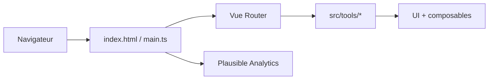

# CorentinTh/it-tools

> Collection of web tools for developers and IT people, running entirely in the browser.

## The problem
Small everyday operations (encoding, hashing, conversions) push people to paste data into unknown sites.

## What it actually does
Vue 3 + TypeScript application served as a static site. Each tool is a module in `src/tools`. According to the architecture, no server-side logic; a usage analytics plugin (Plausible) is present. Self-hosting via container.

## How it is wired


## Trying it
```sh
docker run -d --name it-tools --restart unless-stopped -p 8080:80 corentinth/it-tools:latest
```
Development: `pnpm install`, `pnpm dev`, `pnpm build`, `pnpm test`.

## Cost and gotchas
Free. GPL-3.0: note it if you integrate it. The Plausible usage tracking comes from the architecture inferred from the code; check it on your own instance.

## What it is not
Not a proprietary online service; no storage of your data on the server side according to the code.

## Alternatives
No alternative named in the README.

## For you
Adopt: a local container avoids pasting sensitive data into third-party sites; immediate gain for any technical workstation.
