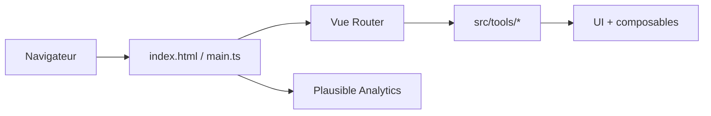

# CorentinTh/it-tools

> Collection d'outils web pour développeurs et personnes en informatique, exécutée entièrement dans le navigateur.

## Le problème
Les petites opérations quotidiennes (encodage, hachage, conversions) poussent à coller des données dans des sites inconnus.

## Ce que ça fait vraiment
Application Vue 3 + TypeScript servie en site statique. Chaque outil est un module dans `src/tools`. D'après l'architecture, aucune logique côté serveur ; un greffon d'analyse d'usage (Plausible) est présent. Auto-hébergement par conteneur.

## Comment c'est branché


## Essayer
```sh
docker run -d --name it-tools --restart unless-stopped -p 8080:80 corentinth/it-tools:latest
```
Développement : `pnpm install`, `pnpm dev`, `pnpm build`, `pnpm test`.

## Coût et pièges
Gratuit. GPL-3.0 : à noter si tu l'intègres. Le suivi d'usage Plausible vient de l'architecture déduite du code ; à vérifier sur ta propre instance.

## Ce que ce n'est pas
Pas un service en ligne propriétaire ; pas de stockage de tes données côté serveur d'après le code.

## Alternatives
Aucune alternative nommée dans le README.

## Pour toi
Adopter : un conteneur local évite de coller des données sensibles dans des sites tiers ; gain immédiat pour tout poste technique.

