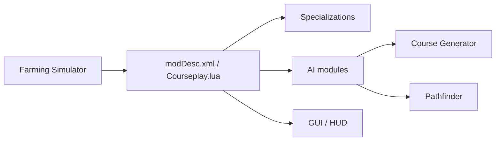

# Courseplay/Courseplay_FS25

> Beta Courseplay mod for Farming Simulator 25: course generation and automatic vehicle driving.

## The problem
Driving farm machines by hand in Farming Simulator is repetitive; the mod automates field courses.

## What it actually does
Lua mod loaded via `modDesc.xml` and `Courseplay.lua`, with vehicle specializations, AI modules (controllers, tasks, jobs), a course generator (genetic algorithm, headlands), pathfinding (A*, Dijkstra, Reeds-Shepp), interface and HUD, XML configurations, translations and GitHub CI. The README only describes the download and bug reports.

## How it is wired

## Trying it
No documented command: download `FS25_Courseplay.zip` from the repository.

## Cost and gotchas
Free but requires the game. Developer version: possible bugs, saved game at risk; the README asks to attach the log to reports. GPL-3.0.

## What it is not
Not an AI project in the ML sense: planned driving control in a game.

## Alternatives
None named in the README.

## For you
Ignore: no link with your data/AI/MLOps profile, apart from curiosity about course coverage algorithms.
