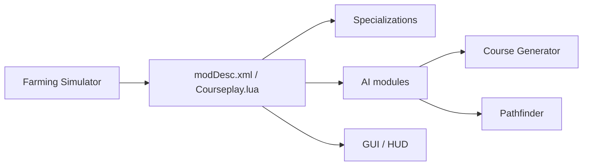

# Courseplay/Courseplay_FS25

> Mod bêta de Courseplay pour Farming Simulator 25 : génération de parcours et conduite automatique de véhicules.

## Le problème
Conduire à la main les machines agricoles dans Farming Simulator est répétitif ; le mod automatise les parcours de champ.

## Ce que ça fait vraiment
Mod Lua chargé via `modDesc.xml` et `Courseplay.lua`, avec spécialisations de véhicules, modules IA (contrôleurs, tâches, jobs), générateur de parcours (algorithme génétique, têtes de champ), recherche de chemin (A*, Dijkstra, Reeds-Shepp), interface et HUD, configurations XML, traductions et CI GitHub. Le README ne décrit que le téléchargement et les rapports de bugs.

## Comment c'est branché

## Essayer
Aucune commande documentée : télécharger `FS25_Courseplay.zip` depuis le dépôt.

## Coût et pièges
Gratuit mais nécessite le jeu. Version développeur : bugs possibles, partie sauvegardée en risque ; le README invite à joindre le journal aux rapports. GPL-3.0.

## Ce que ce n'est pas
Pas un projet IA au sens ML : du pilotage planifié dans un jeu.

## Alternatives
Aucune nommée dans le README.

## Pour toi
À ignorer : aucun lien avec ton profil data/IA/MLOps, hormis la curiosité sur les algorithmes de couverture de parcours.

