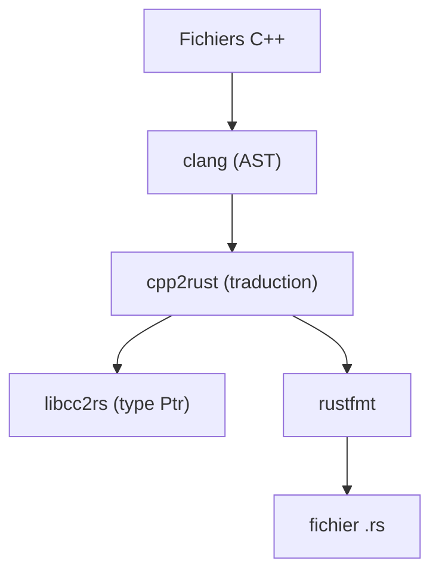

# Cpp2Rust/cpp2rust

> Automatic translator from C++ to fully safe Rust, based on the clang syntax tree.

## The problem
Rewriting C++ by hand into safe Rust is slow and prone to memory-management errors.

## What it actually does
Cpp2Rust parses C++ with clang, walks the tree and writes Rust as text, with calls to the `libcc2rs` library for pointer semantics. The reference-counting model yields safe Rust; `--model=unsafe` generates unsafe Rust. The result is a single `.rs` file formatted by rustfmt. The PLDI 2026 paper describes the algorithm.

## How it is wired
Simplified diagram based on the sheet, no diagram provided.


## Trying it
```bash
mkdir build
cd build
cmake -GNinja ..
ninja
ninja check
./build/cpp2rust/cpp2rust --file=<file>.cpp -o=<file>.rs
./build/cpp2rust/cpp2rust --dir=<dir> -o <output>.rs
```

## Cost and gotchas
Free. libclang-23-dev, clang++-23, ninja, cmake and ruff (pip) are required. Pointers become a type with runtime checks, hence slower.

## What it is not
It is not a guarantee of idiomatic or fast Rust. No success rate is given in the README.

## Alternatives
No alternative named in the README.

## For you
Watch: a strong idea for migrating C++ numerical libraries to Rust, but young and demanding in tooling.
