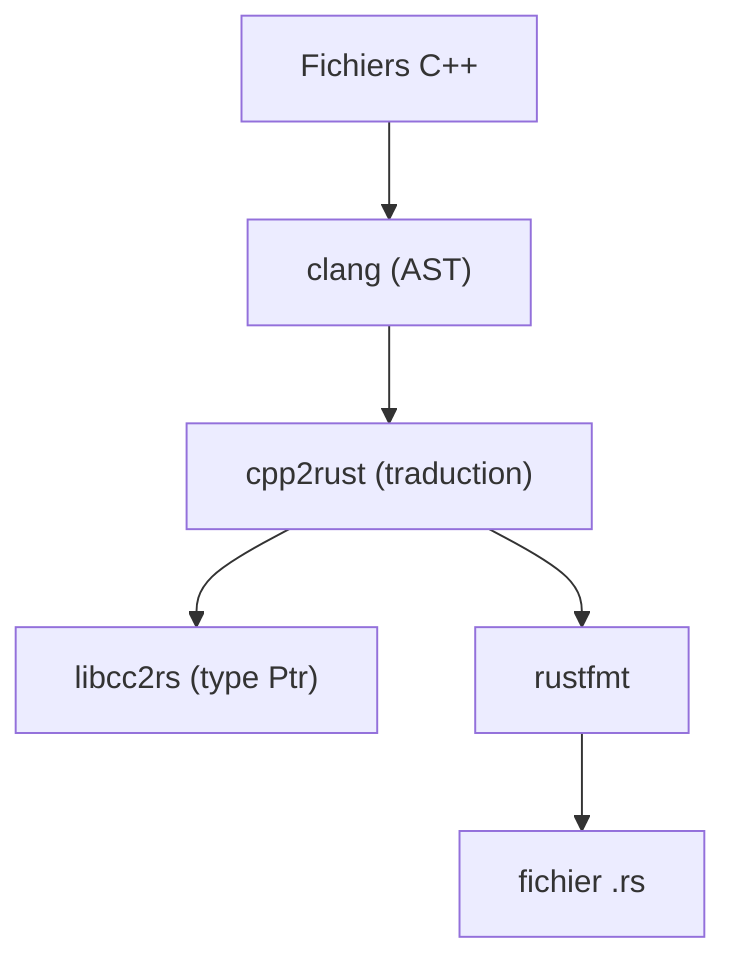

# Cpp2Rust/cpp2rust

> Traducteur automatique de C++ vers du Rust entièrement sûr, fondé sur l'arbre syntaxique de clang.

## Le problème
Réécrire à la main du C++ en Rust sûr est long et sujet aux erreurs de gestion mémoire.

## Ce que ça fait vraiment
Cpp2Rust analyse le C++ avec clang, parcourt l'arbre et écrit du Rust sous forme de texte, avec des appels à la bibliothèque `libcc2rs` pour la sémantique des pointeurs. Le modèle par comptage de références donne du Rust sûr ; `--model=unsafe` génère du Rust non sûr. Le résultat est un seul fichier `.rs` formaté par rustfmt. Le papier PLDI 2026 décrit l'algorithme.

## Comment c'est branché
Schéma simplifié d'après la fiche, sans diagramme fourni.


## Essayer
```bash
mkdir build
cd build
cmake -GNinja ..
ninja
ninja check
./build/cpp2rust/cpp2rust --file=<file>.cpp -o=<file>.rs
./build/cpp2rust/cpp2rust --dir=<dir> -o <output>.rs
```

## Coût et pièges
Gratuit. libclang-23-dev, clang++-23, ninja, cmake et ruff (pip) sont requis. Les pointeurs deviennent un type avec contrôles à l'exécution, donc plus lent.

## Ce que ce n'est pas
Ce n'est pas une garantie de Rust idiomatique ni performant. Aucun taux de réussite n'est donné dans le README.

## Alternatives
Aucune alternative nommée dans le README.

## Pour toi
À surveiller : idée forte pour migrer des bibliothèques de calcul C++ vers Rust, mais jeune et exigeant en outils.

