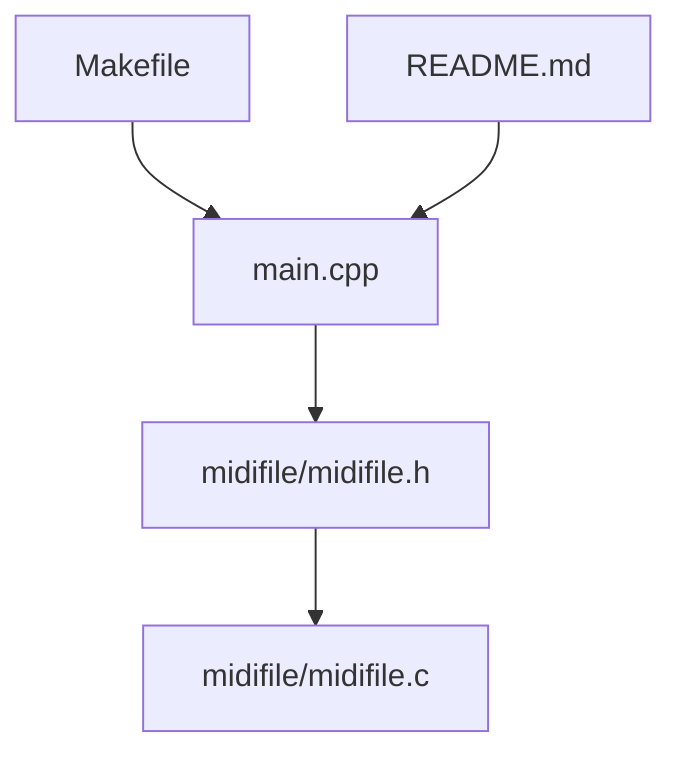

# CrazyCritic89/SteamHapticsSinger

> Program that plays MIDI files on the haptic actuators of a Steam Controller or a Steam Deck.

## The problem
The vibrations of a Steam controller are normally only used for gaming: playing music with them is not intended.

## What it actually does
The program reads a MIDI file and sends the notes to the left and right actuators, with libusb and hidapi. MIDI channels 0 to 3 are assigned to the vibration and trackpad outputs. It supports the 2015 Steam Controller, the 2026 one and the Steam Deck, with loop, interval and gain options.

## How it is wired
Diagram based on the code diagram.


## Trying it
```bash
git clone -b master https://github.com/CrazyCritic89/SteamHapticsSinger.git
cd SteamHapticsSinger
make
chmod +x steam-haptics-singer
./steam-haptics-singer [name of your midi file]
```

## Cost and gotchas
Free. Build requirements: libusb, hidapi-hidraw and pkgconf. You need a Steam controller or a Steam Deck. The BLE firmware must not be installed on the 2015 Steam Controller.

## What it is not
It is not a general MIDI player: only one active note per channel, and most files sound poor without editing.

## Alternatives
The README points to SteamControllerSinger, of which it is the successor.

## For you
Ignore: a hardware curiosity unrelated to data, AI or MLOps.
