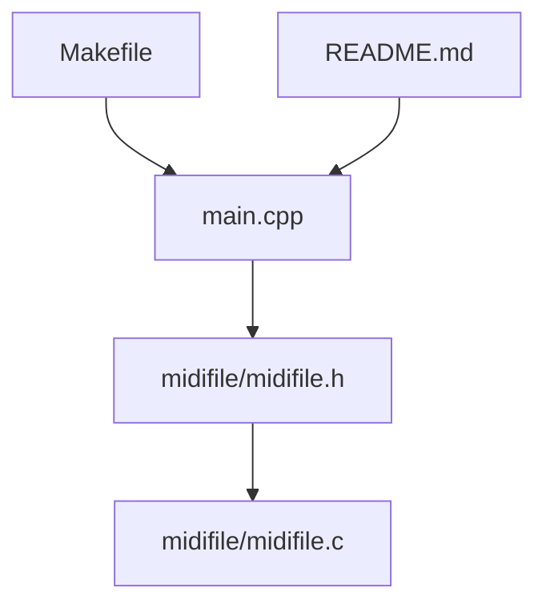

# CrazyCritic89/SteamHapticsSinger

> Programme qui joue des fichiers MIDI sur les actionneurs haptiques d'une Steam Controller ou d'un Steam Deck.

## Le problème
Les vibrations d'une manette Steam ne servent normalement qu'au jeu : jouer de la musique avec n'est pas prévu.

## Ce que ça fait vraiment
Le programme lit un fichier MIDI et envoie les notes aux actionneurs gauche et droit, avec libusb et hidapi. Les canaux MIDI 0 à 3 sont attribués aux sorties de vibration et de pavé tactile. Il prend en charge la Steam Controller 2015, celle de 2026 et le Steam Deck, avec options de boucle, d'intervalle et de gain.

## Comment c'est branché
Schéma d'après le diagramme du code.


## Essayer
```bash
git clone -b master https://github.com/CrazyCritic89/SteamHapticsSinger.git
cd SteamHapticsSinger
make
chmod +x steam-haptics-singer
./steam-haptics-singer [name of your midi file]
```

## Coût et pièges
Gratuit. Compilation : libusb, hidapi-hidraw et pkgconf. Il faut une manette Steam ou un Steam Deck. Le micrologiciel BLE ne doit pas être installé sur la Steam Controller 2015.

## Ce que ce n'est pas
Ce n'est pas un lecteur MIDI général : une seule note active par canal, et la plupart des fichiers rendent mal sans édition.

## Alternatives
Le README renvoie à SteamControllerSinger, dont il est la suite.

## Pour toi
À ignorer : curiosité matérielle sans lien avec la data, l'IA ou le MLOps.

