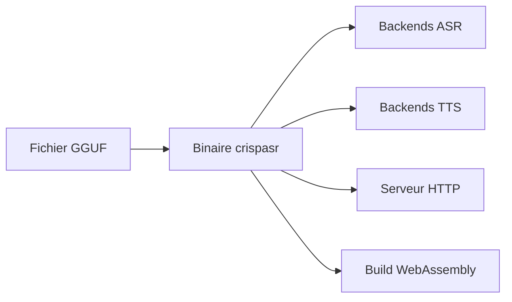

# CrispStrobe/CrispASR

> A single C++ binary for speech recognition and synthesis, with 145 backends on the GGUF format.

## The problem
Each open speech model (Whisper, Parakeet, Voxtral, Qwen3-ASR) comes with its own Python stack and binary.

## What it actually does
A whisper.cpp fork turned unified engine on ggml: one CLI, an HTTP server, a C ABI and bindings for Python, Rust, Dart, Go, Ruby and Java. The backend is chosen on the command line or detected from the GGUF file. It covers transcription, translation, synthesis (69 TTS backends), diarization and audio restoration. A WebAssembly version exists.

## How it is wired
Simplified diagram based on the sheet, no diagram provided.


## Trying it
```bash
crispasr --version
crispasr --backend kokoro -m auto --tts "The quick brown fox jumps over the lazy dog." --tts-output hello.wav
crispasr --backend parakeet -m auto -f hello.wav -l en
```

## Cost and gotchas
Free, the GPU is optional (CPU, CUDA, Metal, Vulkan). Models are downloaded on first use (135 to 467 MB). Model licenses vary, some non-commercial (CC-BY-NC, Raon-Speech, Voxtral TTS). Voice cloning requires `--i-have-rights`. The README is truncated in the provided material.

## What it is not
Not a model: it is a runtime engine. The repo's MIT license does not cover the model weights.

## Alternatives
- Susurrus: Python GUI for 9 ASR backends.
- CrispEmbed: same approach for embeddings and OCR.
- CrisperWeaver: Flutter transcription app based on CrispASR.

## For you
Adopt: running local ASR and TTS without a Python dependency is very useful for prototyping or deploying voice, provided you check each model's license.
