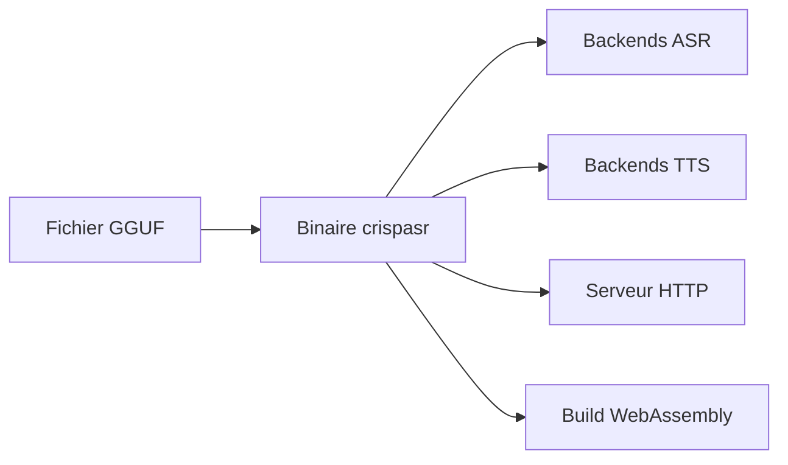

# CrispStrobe/CrispASR

> Un seul binaire C++ pour la reconnaissance et la synthèse vocale, avec 145 backends sur format GGUF.

## Le problème
Chaque modèle vocal ouvert (Whisper, Parakeet, Voxtral, Qwen3-ASR) vient avec sa pile Python et son binaire.

## Ce que ça fait vraiment
Fork de whisper.cpp devenu moteur unifié sur ggml : une CLI, un serveur HTTP, une ABI C et des liaisons Python, Rust, Dart, Go, Ruby et Java. Le backend se choisit en ligne de commande ou se détecte depuis le fichier GGUF. Il couvre transcription, traduction, synthèse (69 backends TTS), diarisation et restauration audio. Une version WebAssembly existe.

## Comment c'est branché
Schéma simplifié d'après la fiche, sans diagramme fourni.


## Essayer
```bash
crispasr --version
crispasr --backend kokoro -m auto --tts "The quick brown fox jumps over the lazy dog." --tts-output hello.wav
crispasr --backend parakeet -m auto -f hello.wav -l en
```

## Coût et pièges
Gratuit, le GPU est optionnel (CPU, CUDA, Metal, Vulkan). Les modèles se téléchargent à la première utilisation (135 à 467 Mo). Licences de modèles variables, certaines non commerciales (CC-BY-NC, Raon-Speech, Voxtral TTS). Le clonage de voix exige `--i-have-rights`. Le README est tronqué dans la matière fournie.

## Ce que ce n'est pas
Ce n'est pas un modèle : c'est un moteur d'exécution. La licence MIT du dépôt ne couvre pas les poids des modèles.

## Alternatives
- Susurrus : interface graphique Python pour 9 backends ASR.
- CrispEmbed : même approche pour les embeddings et l'OCR.
- CrisperWeaver : application Flutter de transcription basée sur CrispASR.

## Pour toi
À adopter : exécuter ASR et TTS locaux sans dépendance Python est très utile pour prototyper ou déployer de la voix, à condition de vérifier la licence de chaque modèle.

