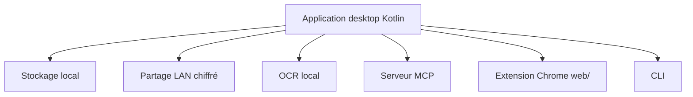

# CrossPaste/crosspaste-desktop

> Clipboard shared between Mac, Windows and Linux on the local network, encrypted, serverless.

## The problem
Copying on one machine and pasting on another means going through a cloud service or a manual transfer.

## What it actually does
Shares clipboard content (text, color, URL, HTML, RTF, image, file) in real time between devices on the same local network. Asymmetric encryption, local storage, local OCR of images. It also offers an MCP server exposing the history to AI assistants, a Chrome extension and a command line.

## How it is wired
Simplified diagram based on the sheet, no diagram provided.



## Trying it
```bash
git clone https://github.com/CrossPaste/crosspaste-desktop.git
cd crosspaste-desktop
./gradlew app:run
./gradlew :web:build
```

## Cost and gotchas
Free. The first launch downloads JBR and the Gradle dependencies (a VPN may be needed). Extension: Node.js 18 or later. AGPL-3.0.

## What it is not
Not a cloud service: local network only. The README does not document an installation binary in this text, only building from source.

## Alternatives
No alternative named in the README.

## For you
Worth watching: the MCP server giving the clipboard history to an assistant is handy, but the AGPL and the privacy stakes call for a careful test.
