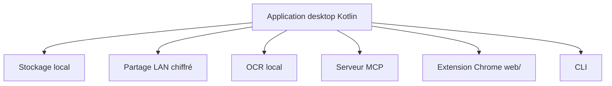

# CrossPaste/crosspaste-desktop

> Presse-papiers partagé entre Mac, Windows et Linux sur le réseau local, chiffré, sans serveur.

## Le problème
Copier sur une machine et coller sur une autre oblige à passer par un service cloud ou un transfert manuel.

## Ce que ça fait vraiment
Partage en temps réel le contenu du presse-papiers (texte, couleur, URL, HTML, RTF, image, fichier) entre appareils du même réseau local. Chiffrement asymétrique, stockage local, OCR local des images. Offre aussi un serveur MCP exposant l'historique à des assistants IA, une extension Chrome et une ligne de commande.

## Comment c'est branché
Schéma simplifié d'après la fiche, sans diagramme fourni.



## Essayer
```bash
git clone https://github.com/CrossPaste/crosspaste-desktop.git
cd crosspaste-desktop
./gradlew app:run
./gradlew :web:build
```

## Coût et pièges
Gratuit. Le premier lancement télécharge JBR et les dépendances Gradle (un VPN peut être nécessaire). Extension : Node.js 18 ou plus. AGPL-3.0.

## Ce que ce n'est pas
Pas un service cloud : réseau local seulement. Le README ne documente pas de binaire d'installation dans ce texte, seulement la compilation.

## Alternatives
Aucune alternative nommée dans le README.

## Pour toi
À surveiller : le serveur MCP donnant l'historique du presse-papiers à un assistant est pratique, mais l'AGPL et l'enjeu de confidentialité demandent un test prudent.

