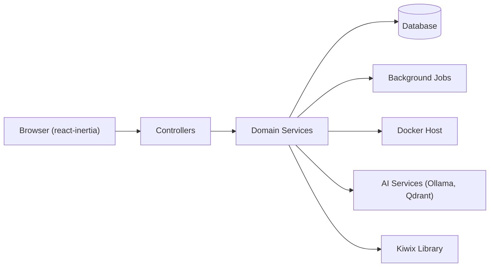

# Crosstalk-Solutions/project-nomad

> Offline knowledge server (Wikipedia, maps, courses, local AI) installable on Debian, for anyone who wants self-reliance.

## The problem
Without internet, no encyclopedia, maps, courses or AI assistant. Assembling these tools yourself (Kiwix, Kolibri, Ollama…) means configuring everything by hand.

## What it actually does
- A "Command Center" interface (AdonisJS + React) that installs and orchestrates Docker containers.
- Offline library (Kiwix), courses (Kolibri), maps (ProtoMaps), CyberChef, notes (FlatNotes).
- Local AI assistant via Ollama (or an OpenAI-compatible API) with RAG on Qdrant.
- Optional automatic updates, hardware benchmark.

## How it is wired


## Trying it
```bash
sudo apt-get update && sudo apt-get install -y curl
curl -fsSL https://raw.githubusercontent.com/Crosstalk-Solutions/project-nomad/refs/heads/main/install/install_nomad.sh -o install_nomad.sh
sudo bash install_nomad.sh
# puis http://localhost:8080
```

## Cost and gotchas
The core needs about 5 GB and under 1 GB of RAM; with AI, plan for about 25 GB and a GPU (RTX 3060 recommended). Install script run as root via curl. No built-in authentication: do not expose it to the internet.

## What it is not
Not a secure multi-user product (no auth, the README is explicit). Not lightweight if you enable AI. The offline content you download fills the disk, not the tool.

## Alternatives
The named components (Kiwix, Kolibri, Ollama) can be used on their own if you only need one building block.

## For you
Worth watching: the local RAG building block (Ollama + Qdrant) is interesting, but the whole is a survival server outside the core data/MLOps business.
