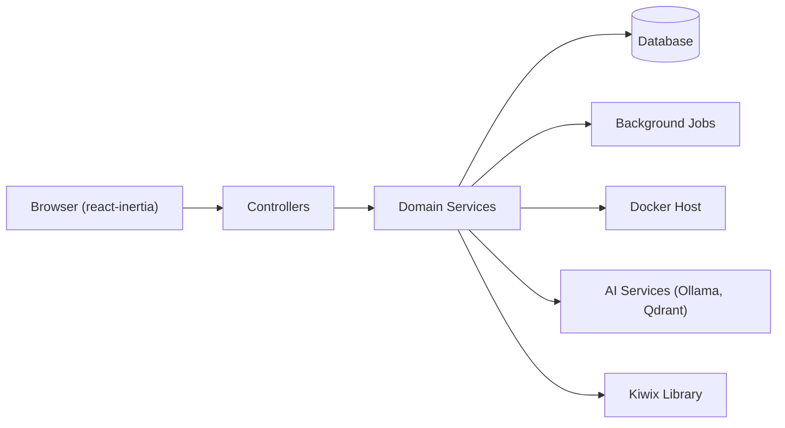

# Crosstalk-Solutions/project-nomad

> Serveur de savoir hors ligne (Wikipédia, cartes, cours, IA locale) installable sur Debian, pour qui veut l'autonomie.

## Le problème
Sans internet, plus d'encyclopédie, de cartes, de cours ni d'assistant IA. Assembler ces outils soi-même (Kiwix, Kolibri, Ollama…) demande de tout configurer à la main.

## Ce que ça fait vraiment
- Une interface « Command Center » (AdonisJS + React) qui installe et orchestre des conteneurs Docker.
- Bibliothèque offline (Kiwix), cours (Kolibri), cartes (ProtoMaps), CyberChef, notes (FlatNotes).
- Assistant IA local via Ollama (ou API compatible OpenAI) avec RAG sur Qdrant.
- Mises à jour automatiques optionnelles, benchmark matériel.

## Comment c'est branché


## Essayer
```bash
sudo apt-get update && sudo apt-get install -y curl
curl -fsSL https://raw.githubusercontent.com/Crosstalk-Solutions/project-nomad/refs/heads/main/install/install_nomad.sh -o install_nomad.sh
sudo bash install_nomad.sh
# puis http://localhost:8080
```

## Coût et pièges
Le noyau demande environ 5 Go et moins de 1 Go de RAM ; avec l'IA, compter environ 25 Go et un GPU (RTX 3060 conseillée). Script d'installation lancé en root via curl. Aucune authentification intégrée : ne pas exposer à internet.

## Ce que ce n'est pas
Pas un produit multi-utilisateurs sécurisé (pas d'auth, README explicite). Pas léger si tu actives l'IA. Le contenu offline à télécharger remplit le disque, pas l'outil.

## Alternatives
Les composants nommés (Kiwix, Kolibri, Ollama) s'utilisent seuls si tu n'as besoin que d'une brique.

## Pour toi
À surveiller : la brique RAG locale (Ollama + Qdrant) est intéressante, mais l'ensemble est un serveur de survie hors cœur de métier data/MLOps.

