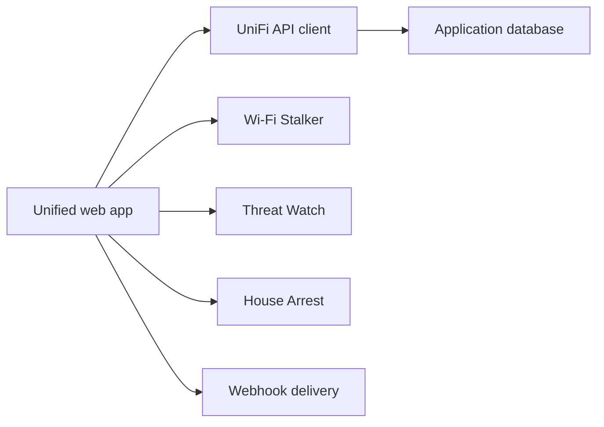

# Crosstalk-Solutions/unifi-toolkit

> Web application for monitoring and locking down UniFi networks, for network administrators.

## The problem
Tracking devices, IDS/IPS threats and firewall rules on a UniFi controller means juggling several screens.

## What it actually does
A FastAPI app bundles four tools: Wi-Fi Stalker (device tracking, roaming, webhook alerts), Threat Watch (IDS/IPS events), Network Pulse (real-time dashboard) and House Arrest (zone-based firewall lockdown, with a preview before applying). Controller credentials are entered in the interface and stored encrypted in the database.

## How it is wired


## Trying it
```bash
git clone https://github.com/Crosstalk-Solutions/unifi-toolkit.git
cd unifi-toolkit
./setup.sh
docker compose up -d
```

## Cost and gotchas
Free. Requires a UniFi OS controller (standalone controllers are no longer supported since v1.11.0) and the zone-based firewall (Network 9.0+). Local mode has no authentication.

## What it is not
Not an Ubiquiti product (the README states there is no affiliation). No access through the unifi.ui.com cloud. Unrelated to data or AI.

## Alternatives
No alternative named in the README.

## For you
Ignore for data/MLOps work: useful only if you administer a UniFi network at home or at the office.
