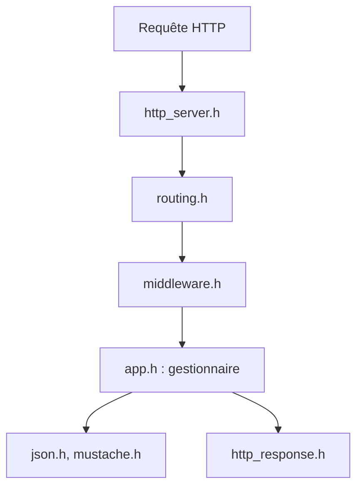

# CrowCpp/Crow

> Header-only C++ micro-framework for HTTP and WebSocket services, with Flask-inspired routing.

## The problem
Writing a web server in C++ by hand with Boost.Asio is long and verbose.

## What it actually does
Crow provides Flask-style routing (`CROW_ROUTE`), typed handlers checked at compile time, built-in JSON, Mustache templates, middleware, HTTP/1.1, WebSocket and multipart. It is "header only" (a single header file is possible). Async and HTTP/2 are indicated as under development.

## How it is wired


## Trying it
```bash
# Code du README (compilation : voir la documentation externe)
```
```cpp
#include "crow.h"
int main() {
    crow::SimpleApp app;
    CROW_ROUTE(app, "/")([](){ return "Hello world"; });
    app.port(18080).multithreaded().run();
}
```

## Cost and gotchas
Free. License not identified by GitHub and the repository is derived from `ipkn/crow` under BSD-3: check before commercial use. The advertised performance relies on external benchmarks.

## What it is not
Not a full framework like Django: no ORM or authentication provided. The project states it has no connection with the original author.

## Alternatives
- ipkn/crow: the original project it derives from (not maintained by this team).

## For you
Ignore: a C++ server for very specific cases; in data and MLOps, a Python server almost always suffices.
