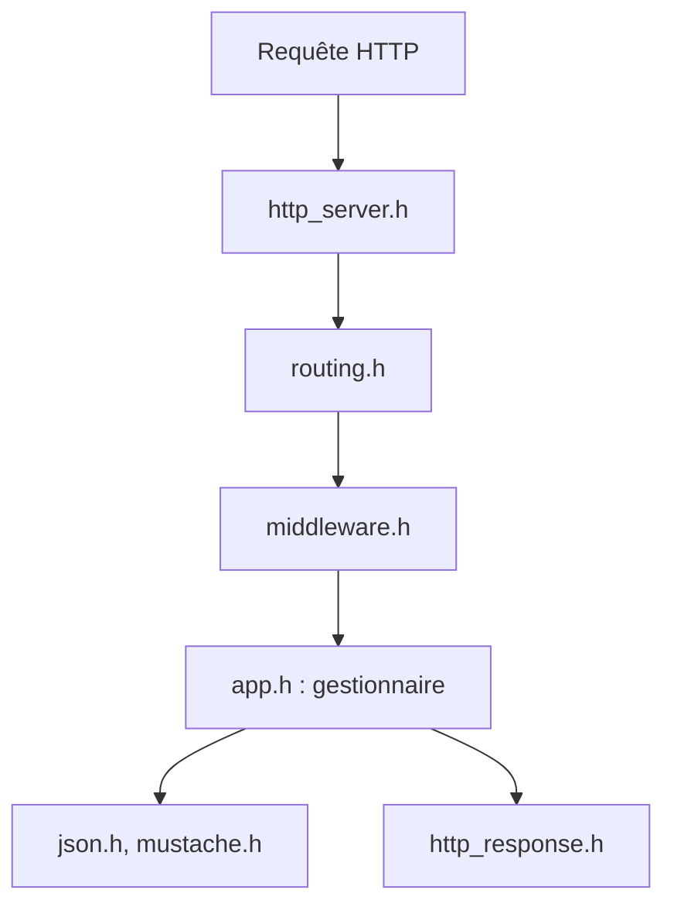

# CrowCpp/Crow

> Micro-framework C++ en en-têtes pour services HTTP et WebSocket, avec un routage inspiré de Flask.

## Le problème
Écrire un serveur web en C++ à la main avec Boost.Asio est long et verbeux.

## Ce que ça fait vraiment
Crow fournit un routage type Flask (`CROW_ROUTE`), des gestionnaires typés vérifiés à la compilation, JSON intégré, modèles Mustache, intergiciels, HTTP/1.1, WebSocket et multipart. Il est « header only » (un fichier d'en-tête possible). L'asynchrone et HTTP/2 sont indiqués en cours de développement.

## Comment c'est branché


## Essayer
```bash
# Code du README (compilation : voir la documentation externe)
```
```cpp
#include "crow.h"
int main() {
    crow::SimpleApp app;
    CROW_ROUTE(app, "/")([](){ return "Hello world"; });
    app.port(18080).multithreaded().run();
}
```

## Coût et pièges
Gratuit. Licence non identifiée par GitHub et dépôt dérivé de `ipkn/crow` sous BSD-3 : à vérifier avant usage commercial. Les performances annoncées s'appuient sur des benchmarks externes.

## Ce que ce n'est pas
Pas un framework complet type Django : pas d'ORM ni d'authentification fournis. Le projet précise n'avoir aucun lien avec l'auteur d'origine.

## Alternatives
- ipkn/crow : projet d'origine dont il dérive (non maintenu par cette équipe).

## Pour toi
À ignorer : serveur C++ pour des cas très spécifiques ; en data et MLOps, un serveur Python suffit presque toujours.

