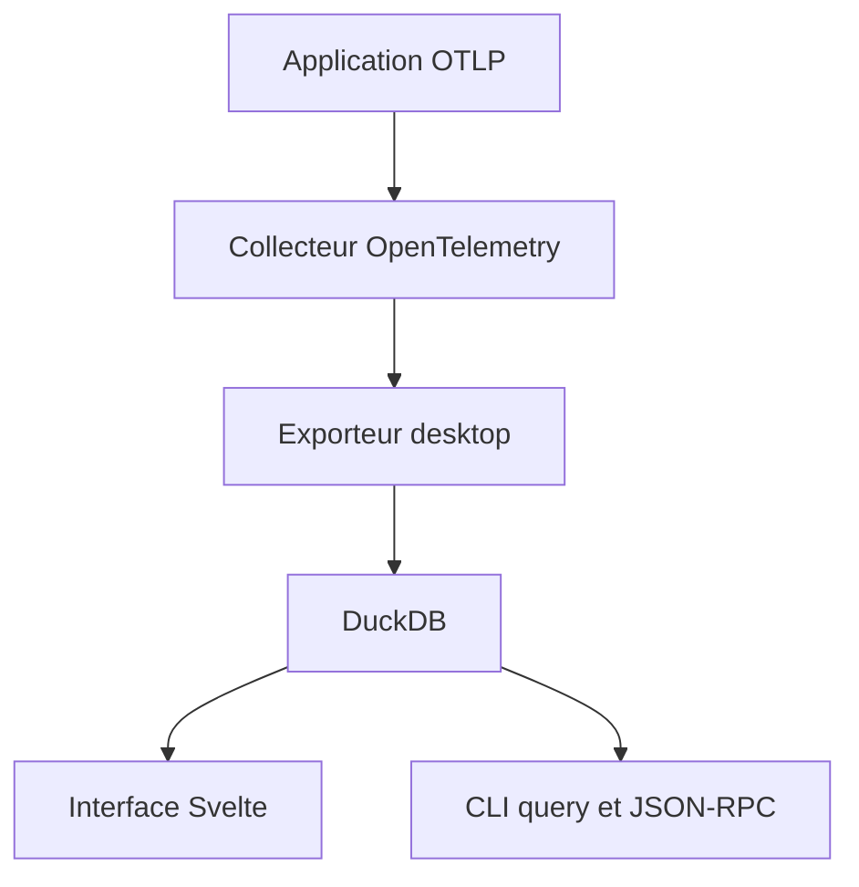

# CtrlSpice/otel-desktop-viewer

> Local viewer for OpenTelemetry traces, metrics and logs, for debugging in development without an observability backend.

## The problem
Seeing what an OpenTelemetry-instrumented application emits often means standing up Jaeger or a full SaaS.

## What it actually does
A single binary receives OTLP over gRPC (4317) and HTTP (4318), stores data in DuckDB (in memory by default, in a file with `--db`) and serves a Svelte interface on port 8000. A CLI queries the data with SQL or by searching traces, logs and metrics. It also provides `llms.txt` and a skill for agents.

## How it is wired


## Trying it
```bash
docker run -p 8000:8000 -p 4317:4317 -p 4318:4318 ghcr.io/ctrlspice/otel-desktop-viewer:latest
export OTEL_EXPORTER_OTLP_ENDPOINT="http://localhost:4318"
otel-desktop-viewer query 'SELECT service_name, count(*) FROM spans GROUP BY service_name'
```

## Cost and gotchas
Free. Linux binaries require glibc 2.39 or later. Storage is capped (512 MB in memory, 2 GB with `--db`), and the oldest data is purged. An incompatible schema is rejected.

## What it is not
Not a production observability platform: it is a local tool. It does not aggregate several machines.

## Alternatives
No named alternative, apart from `otel-cli` for emitting test traces.

## For you
Adopt: a simple way to check the OpenTelemetry instrumentation of a pipeline or an inference service locally, without infrastructure.
