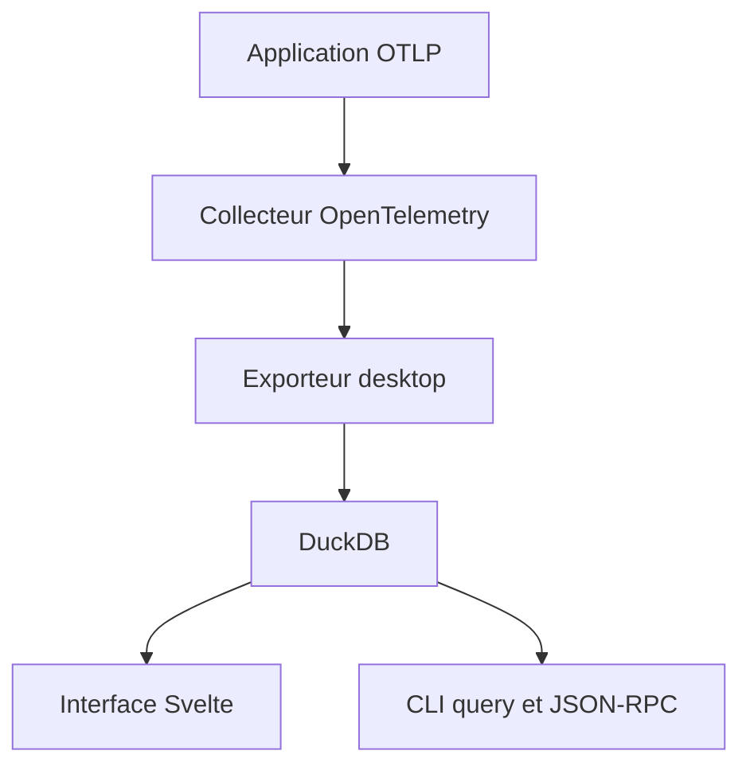

# CtrlSpice/otel-desktop-viewer

> Visionneuse locale de traces, métriques et logs OpenTelemetry, pour déboguer en développement sans backend d'observabilité.

## Le problème
Voir ce qu'émet une application instrumentée OpenTelemetry oblige souvent à monter Jaeger ou un SaaS complet.

## Ce que ça fait vraiment
Un seul binaire reçoit l'OTLP en gRPC (4317) et HTTP (4318), stocke dans DuckDB (mémoire par défaut, fichier avec `--db`) et sert une interface Svelte sur le port 8000. Une CLI interroge les données en SQL ou par recherche de traces, logs et métriques. Il fournit aussi `llms.txt` et un skill pour agents.

## Comment c'est branché


## Essayer
```bash
docker run -p 8000:8000 -p 4317:4317 -p 4318:4318 ghcr.io/ctrlspice/otel-desktop-viewer:latest
export OTEL_EXPORTER_OTLP_ENDPOINT="http://localhost:4318"
otel-desktop-viewer query 'SELECT service_name, count(*) FROM spans GROUP BY service_name'
```

## Coût et pièges
Gratuit. Binaires Linux exigeant glibc 2.39 ou plus. Stockage plafonné (512 Mo en mémoire, 2 Go avec `--db`), le plus ancien est purgé. Un schéma incompatible est rejeté.

## Ce que ce n'est pas
Pas une plateforme d'observabilité de production : c'est un outil local. Il n'agrège pas plusieurs machines.

## Alternatives
Aucune alternative nommée, hors `otel-cli` pour émettre des traces de test.

## Pour toi
À adopter : un moyen simple de vérifier l'instrumentation OpenTelemetry d'un pipeline ou d'un service d'inférence en local, sans infrastructure.

