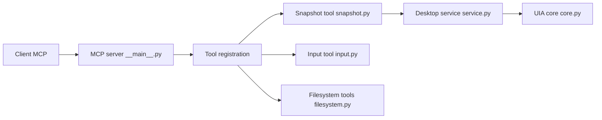

# CursorTouch/Windows-MCP

> MCP server that lets an agent control Windows: clicks, typing, files, PowerShell, registry.

## The problem
An agent has no hold on the Windows desktop: no windows, no keyboard, no files, no applications.

## What it actually does
Exposes about twenty MCP tools (`Click`, `Type`, `Snapshot`, `Screenshot`, `App`, `PowerShell`, `FileSystem`, `Registry`, `Process`…). Reads the UI Automation tree to provide element identifiers, with a DOM mode for browsers. stdio, SSE and streamable HTTP transports, with authentication, IP allowlist, TLS and OAuth 2.0 + PKCE. A desktop-control policy (relaxed, balanced, strict) avoids getting in the user's way.

## How it is wired


## Trying it
```bash
uvx windows-mcp serve
claude mcp add --transport stdio windows-mcp -- uvx windows-mcp serve
windows-mcp install
windows-mcp auth
```

## Cost and gotchas
Free; Python 3.14+ and `uv` required, slow first installation. The README speaks of full system access with irreversible operations. Anonymous telemetry is on by default (`ANONYMIZED_TELEMETRY=false` to turn it off). Only expose it on the network with a key, TLS and an IP allowlist.

## What it is not
Not a security boundary: the user's takeover of control is "best-effort". Not meant for gaming. Fine-grained text selection and typing code in an IDE are listed as limitations.

## Alternatives
No alternative named in the README.

## For you
Worth watching: powerful for automating a Windows workstation, but it gives control over PowerShell and the registry; restrict the tools (`--exclude-tools`) before any real use.
