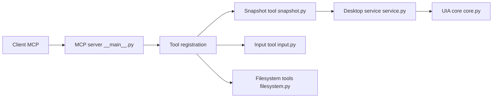

# CursorTouch/Windows-MCP

> Serveur MCP qui laisse un agent contrôler Windows : clics, saisie, fichiers, PowerShell, registre.

## Le problème
Un agent n'a aucune prise sur le bureau Windows : ni fenêtres, ni clavier, ni fichiers, ni applications.

## Ce que ça fait vraiment
Expose une vingtaine d'outils MCP (`Click`, `Type`, `Snapshot`, `Screenshot`, `App`, `PowerShell`, `FileSystem`, `Registry`, `Process`…). Lit l'arbre UI Automation pour donner des identifiants d'éléments, avec un mode DOM pour les navigateurs. Transports stdio, SSE et HTTP en flux, avec authentification, liste d'IP autorisées, TLS et OAuth 2.0 + PKCE. Une politique de contrôle du bureau (relaxed, balanced, strict) évite de gêner l'utilisateur.

## Comment c'est branché


## Essayer
```bash
uvx windows-mcp serve
claude mcp add --transport stdio windows-mcp -- uvx windows-mcp serve
windows-mcp install
windows-mcp auth
```

## Coût et pièges
Gratuit ; Python 3.14+ et `uv` requis, première installation lente. Le README parle d'un accès système complet avec opérations irréversibles. La télémétrie anonyme est active par défaut (`ANONYMIZED_TELEMETRY=false` pour la couper). Ne l'expose en réseau qu'avec clé, TLS et liste d'IP.

## Ce que ce n'est pas
Pas une frontière de sécurité : la prise de contrôle par l'utilisateur est « best-effort ». Ne sert pas à jouer. Sélection de texte fine et saisie de code dans un IDE sont listées comme limitations.

## Alternatives
Aucune alternative nommée dans le README.

## Pour toi
À surveiller : puissant pour automatiser un poste Windows, mais il donne la main sur PowerShell et le registre ; restreins les outils (`--exclude-tools`) avant tout usage réel.

