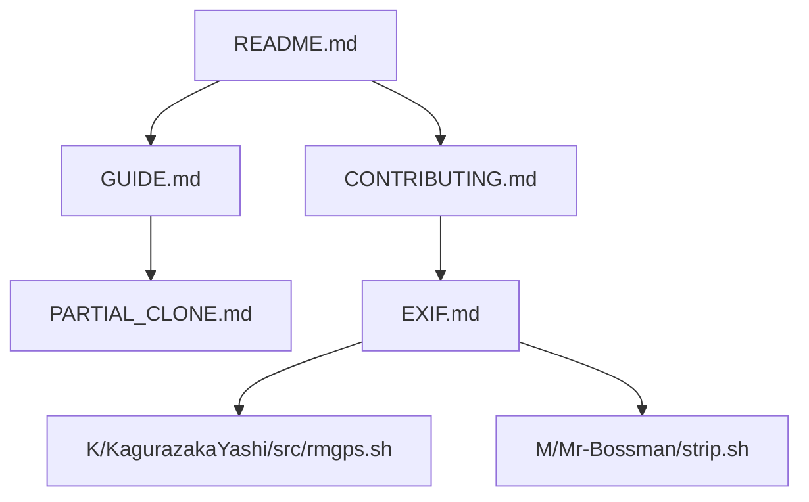

# Cute-Dress/Dress

> Practice repository for Git and GitHub where everyone submits a folder with their images, with no code to write.

## The problem
Learning the fork, branch, commit, pull request workflow with no real stakes is hard without a risk-free project.

## What it actually does
A tree of folders sorted by initial where each contributor drops a README and images. It contains guides (contributing, getting started, partial clone, EXIF cleanup), English and Japanese translations, and a few metadata-removal scripts. The naming rules are precise, and images must be lightweight and stripped of their EXIF data.

## How it is wired

## Trying it
No command documented in the README, which is written in Chinese: it points to a beginner's guide and a partial clone guide.

## Cost and gotchas
Free. The content consists of photos of people: strip the EXIF, only publish images you hold the rights to. CC BY-NC-SA 4.0 license according to the README (commercial use excluded), not identified by GitHub.

## What it is not
Not a tool nor a library: a practice ground. Not a dataset usable for AI, since the photos are personal and the license forbids commercial use.

## Alternatives
No alternative cited in the README.

## For you
Ignore: no data or MLOps value, and the content is photos of people that must not be harvested.
