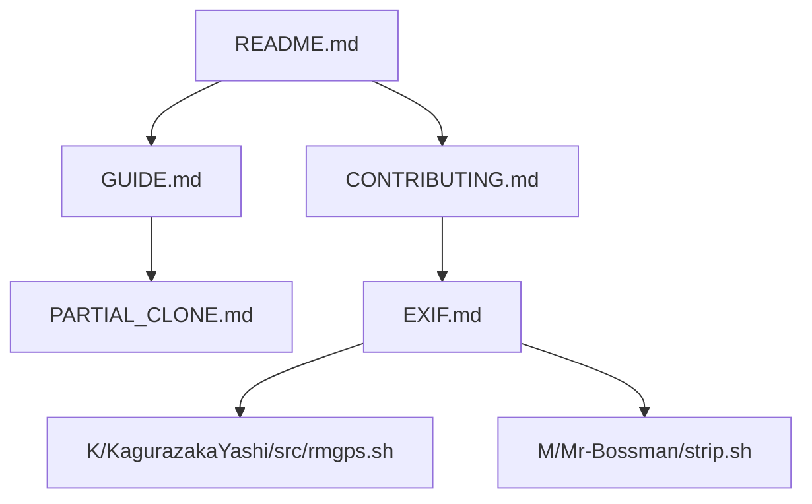

# Cute-Dress/Dress

> Dépôt d'entraînement à Git et GitHub où chacun dépose un dossier avec ses images, sans code à écrire.

## Le problème
Apprendre le flux fork, branche, commit, pull request sans enjeu réel est difficile faute d'un projet sans risque.

## Ce que ça fait vraiment
Un arbre de dossiers classés par initiale où chaque contributeur dépose un README et des images. Il contient des guides (contribuer, démarrage, clone partiel, nettoyage EXIF), des traductions anglaise et japonaise, et quelques scripts de retrait de métadonnées. Les règles de nommage sont précises, et les images doivent être légères et débarrassées de leurs données EXIF.

## Comment c'est branché

## Essayer
Aucune commande documentée dans le README, rédigé en chinois : il renvoie à un guide du débutant et à un guide de clone partiel.

## Coût et pièges
Gratuit. Le contenu est composé de photos de personnes : retirer l'EXIF, ne publier que des images dont tu as les droits. Licence CC BY-NC-SA 4.0 d'après le README (usage commercial exclu), non identifiée par GitHub.

## Ce que ce n'est pas
Pas un outil ni une bibliothèque : un terrain d'exercice. Pas un jeu de données exploitable pour l'IA, car les photos sont personnelles et la licence interdit l'usage commercial.

## Alternatives
Aucune alternative citée dans le README.

## Pour toi
Ignorer : pas de valeur data ou MLOps, et le contenu est des photos de personnes à ne pas moissonner.

