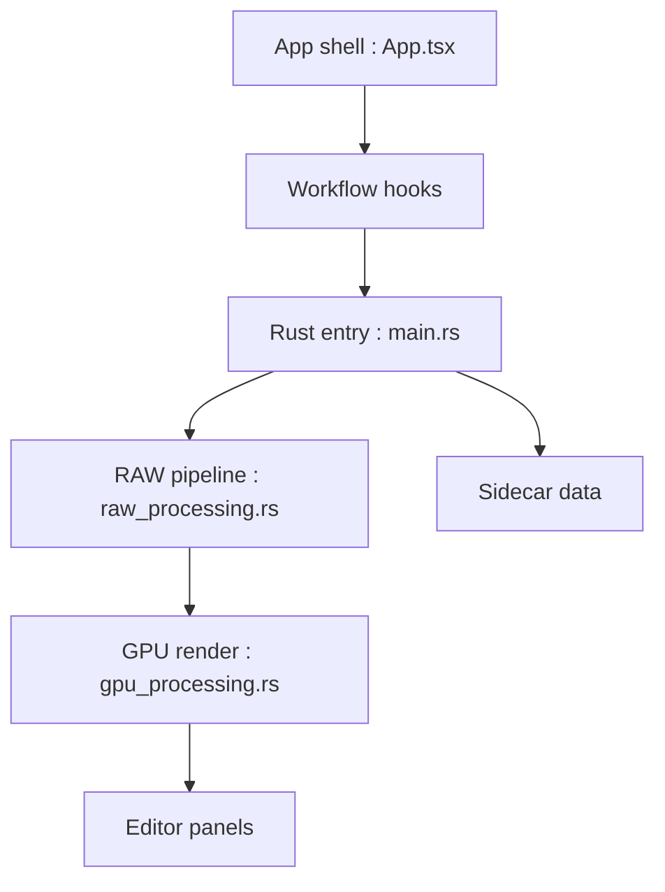

# CyberTimon/RapidRAW

> GPU-accelerated non-destructive RAW photo editor, for photographers on Windows, macOS, Linux and Android.

## The problem
Editing RAW photos with a fast, simple tool, as an alternative to Lightroom.

## What it actually does
The application decodes RAW files with rawler, applies adjustments through WGSL shaders via wgpu and keeps edits in `.rrdata` sidecar files. It offers masks, a photo library, batch export, panorama, HDR, denoising. Local AI models are used for masks, and ComfyUI is optional for generation.

## How it is wired

## Trying it
No command in the provided README: it points to the latest release download page.

## Cost and gotchas
Free, AGPL-3.0 license (network copyleft) with no alert declared in this list. A GPU is useful for rendering and AI models; models are downloaded on use. The provided README is truncated after the changelog.

## What it is not
It is not a data science tool: it is a desktop photo application. It is not an embeddable module.

## Alternatives
No alternative named, apart from Adobe Lightroom cited as a reference.

## For you
Ignore: consumer photo editor, unrelated to a data, AI or MLOps profile, unless you have a hobby interest.
