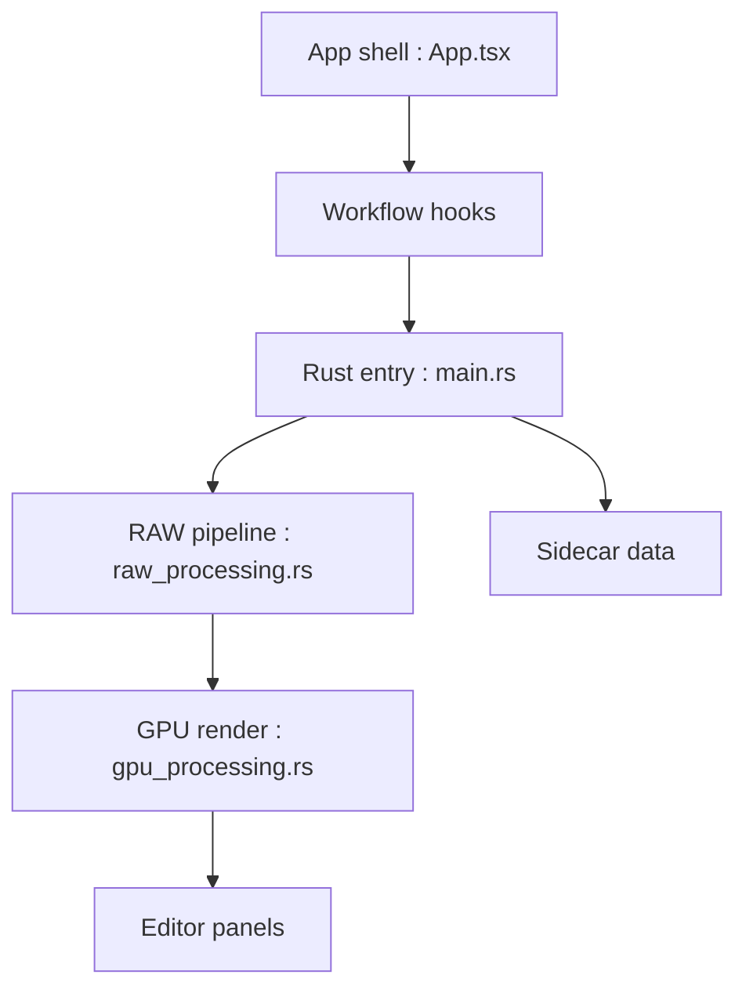

# CyberTimon/RapidRAW

> Éditeur photo RAW non destructif accéléré par GPU, pour photographes sur Windows, macOS, Linux et Android.

## Le problème
Retoucher des photos RAW avec un outil rapide et simple, alternative à Lightroom.

## Ce que ça fait vraiment
L'application décode les RAW avec rawler, applique les réglages par shaders WGSL via wgpu et garde les modifications dans des fichiers annexes `.rrdata`. Elle propose masques, bibliothèque de photos, export par lot, panorama, HDR, débruitage. Des modèles d'IA locaux servent aux masques, et ComfyUI est optionnel pour la génération.

## Comment c'est branché

## Essayer
Aucune commande dans le README fourni : il renvoie à la page de téléchargement de la dernière version.

## Coût et pièges
Gratuit, licence AGPL-3.0 (copyleft réseau) sans alerte déclarée dans cette liste. Un GPU est utile pour le rendu et les modèles d'IA ; des modèles se téléchargent à l'usage. Le README fourni est tronqué après le journal des changements.

## Ce que ce n'est pas
Ce n'est pas un outil de data science : c'est une application de bureau pour la photo. Ce n'est pas un module intégrable.

## Alternatives
Aucune alternative nommée, hors Adobe Lightroom cité comme référence.

## Pour toi
Ignorer : éditeur photo grand public, sans rapport avec un profil data, IA ou MLOps, sauf intérêt de loisir.

