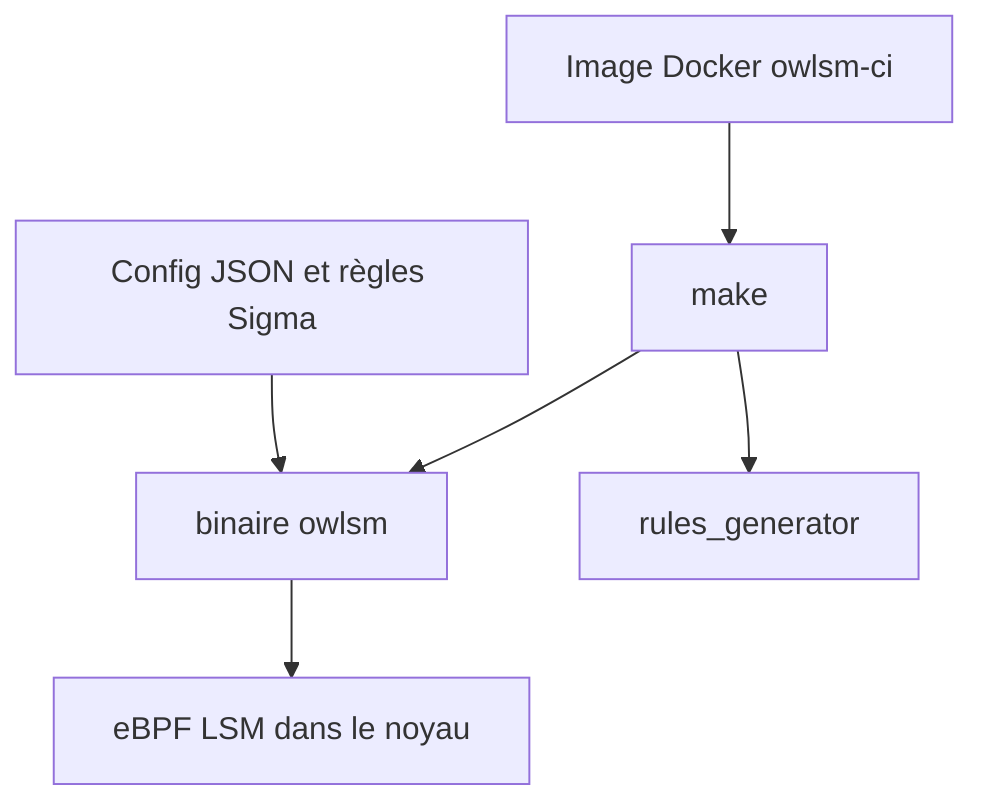

# Cybereason-Public/owLSM

> Linux eBPF LSM agent that applies Sigma rules to prevent attacks, for security teams.

## The problem
Falco, Tetragon or KubeArmor mostly detect, or block statelessly: few matches by substring, regular expression or full command line.

## What it actually does
A Sigma rule engine runs in the kernel via eBPF LSM. Stateful programs correlate several hook points, which makes it possible to block a write based on the shell command that initiated it. Each monitoring event carries the context an analyst needs.

## How it is wired
Simplified diagram based on the sheet, no diagram provided.


## Trying it
```bash
docker pull ghcr.io/cybereason-public/owlsm-ci:latest
docker run -it --rm -v "$PWD":/workspace -w /workspace ghcr.io/cybereason-public/owlsm-ci:latest bash
make -j$(nproc)
cd build/owlsm/bin
sudo ./owlsm -c /config/path.json
```

## Cost and gotchas
Built inside Docker, run outside the container with sudo. Startup takes 10 to 50 seconds (eBPF verifier). Kernel 5.14 minimum on x86_64, 6.4 on aarch64; no cloud support for now.

## What it is not
A defensive tool: it blocks, it does not attack. It is not a turnkey product, and the license is GPL-2.0.

## Alternatives
Falco, Tetragon, KubeArmor: cited by the authors, who consider their prevention limited.

## For you
Worth watching: useful if you secure Linux training or inference servers, but it is a kernel security tool, not a data one.
