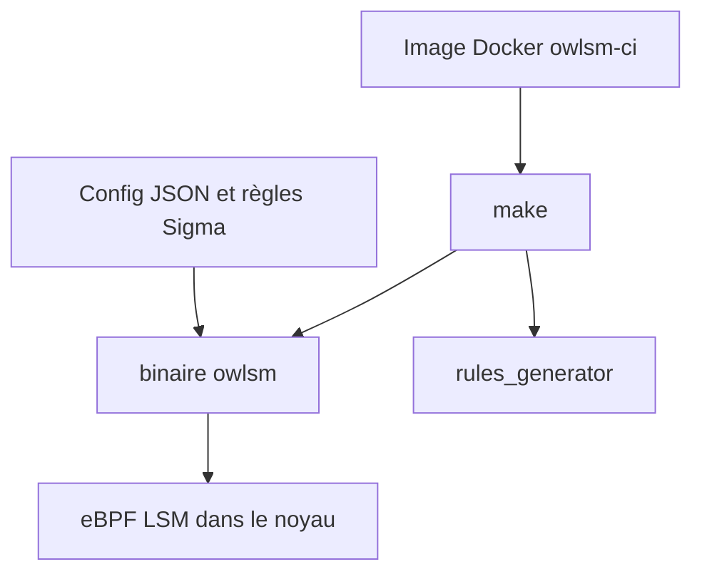

# Cybereason-Public/owLSM

> Agent Linux eBPF LSM qui applique des règles Sigma pour prévenir les attaques, pour les équipes sécurité.

## Le problème
Falco, Tetragon ou KubeArmor détectent surtout, ou bloquent sans état : peu de correspondances par sous-chaîne, expression régulière ou ligne de commande complète.

## Ce que ça fait vraiment
Un moteur de règles Sigma tourne dans le noyau via eBPF LSM. Des programmes avec état corrèlent plusieurs points d'accrochage, ce qui permet de bloquer une écriture selon la commande shell qui l'a initiée. Chaque événement de surveillance porte le contexte utile à un analyste.

## Comment c'est branché
Schéma simplifié d'après la fiche, sans diagramme fourni.


## Essayer
```bash
docker pull ghcr.io/cybereason-public/owlsm-ci:latest
docker run -it --rm -v "$PWD":/workspace -w /workspace ghcr.io/cybereason-public/owlsm-ci:latest bash
make -j$(nproc)
cd build/owlsm/bin
sudo ./owlsm -c /config/path.json
```

## Coût et pièges
Compilation dans Docker, exécution hors conteneur avec sudo. Démarrage de 10 à 50 secondes (vérificateur eBPF). Noyau 5.14 minimum en x86_64, 6.4 en aarch64 ; pas de support cloud pour l'instant.

## Ce que ce n'est pas
Un outil défensif : il bloque, il n'attaque pas. Ce n'est pas un produit clé en main, et la licence est GPL-2.0.

## Alternatives
Falco, Tetragon, KubeArmor : cités par les auteurs, qui jugent leur prévention limitée.

## Pour toi
À surveiller : utile si tu sécurises des serveurs Linux d'entraînement ou d'inférence, mais c'est un outil de sécurité noyau, pas de data.

