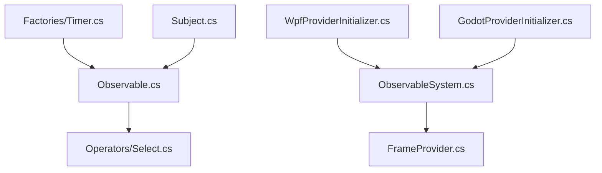

# Cysharp/R3

> Reimplementation of Reactive Extensions for modern C#, with support for Unity, Godot, WPF and others.

## The problem
Classic Rx stops at the first error, slows down because of `IScheduler`, and ignores the frame-based slicing of game engines.

## What it actually does
R3 keeps the Rx API but changes the interfaces: `OnErrorResume` no longer cuts the subscription, `OnCompleted(Result)` groups completion and failure, `TimeProvider` replaces `IScheduler`. It adds per-frame operators (`FrameProvider`), subjects including `ReactiveProperty`, subscription tracking (`ObservableTracker`) and per-platform adapters.

## How it is wired


## Trying it
```bash
dotnet add package R3
```

## Cost and gotchas
Free. It targets .NET Standard 2.0 and 2.1, .NET 6 and 8 or later; Unity, Godot and WPF require their own installation step. Lightweight subjects behave slightly differently in multithreading. It does not reuse `IObservable`, so existing Rx code must be migrated.

## What it is not
It is not a transparent replacement for dotnet/reactive: the interfaces differ. It handles neither distributed queries nor network reactive streams.

## Alternatives
dotnet/reactive: the ecosystem reference, to keep if you depend on `IObservable`; neuecc/UniRx: predecessor in Unity; runceel/ReactiveProperty: standalone library for XAML binding.

## For you
Ignore: a C# library for interfaces and games, with no direct link to data, AI or MLOps.
