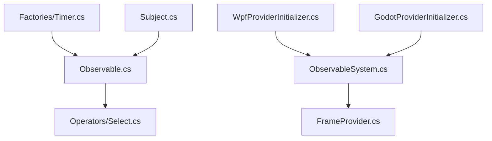

# Cysharp/R3

> Réimplémentation des Reactive Extensions pour C# moderne, avec prise en charge d'Unity, Godot, WPF et d'autres.

## Le problème
Les Rx classiques s'arrêtent à la première erreur, ralentissent à cause d'`IScheduler` et ignorent le découpage par images des moteurs de jeu.

## Ce que ça fait vraiment
R3 garde l'API Rx mais change les interfaces : `OnErrorResume` ne coupe plus l'abonnement, `OnCompleted(Result)` regroupe fin et échec, `TimeProvider` remplace `IScheduler`. Il ajoute des opérateurs par image (`FrameProvider`), des sujets dont `ReactiveProperty`, un suivi des abonnements (`ObservableTracker`) et des adaptateurs par plateforme.

## Comment c'est branché


## Essayer
```bash
dotnet add package R3
```

## Coût et pièges
Gratuit. Il vise .NET Standard 2.0 et 2.1, .NET 6 et 8 ou plus ; Unity, Godot et WPF demandent une étape d'installation propre. Les sujets légers se comportent un peu différemment en multitâche. Il ne reprend pas `IObservable`, donc le code Rx existant se migre.

## Ce que ce n'est pas
Ce n'est pas un remplacement transparent de dotnet/reactive : les interfaces diffèrent. Il ne gère ni requêtes distribuées ni flux réactifs réseau.

## Alternatives
dotnet/reactive : référence de l'écosystème, à garder si tu dépends de `IObservable` ; neuecc/UniRx : prédécesseur dans Unity ; runceel/ReactiveProperty : bibliothèque autonome pour la liaison XAML.

## Pour toi
À ignorer : bibliothèque C# pour interfaces et jeux, sans lien direct avec la data, l'IA ou le MLOps.

