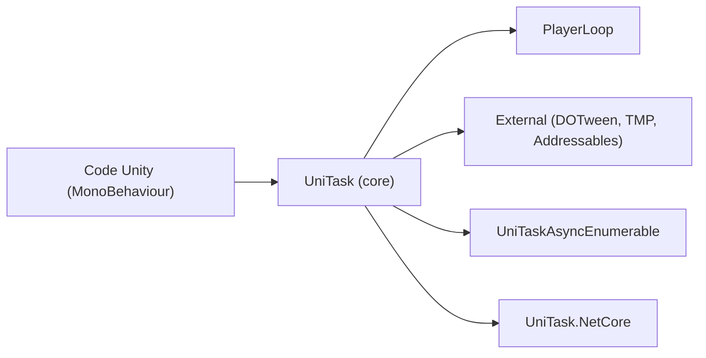

# Cysharp/UniTask

> Allocation-free async/await for Unity, built on the PlayerLoop.

## The problem
`Task` is heavy and poorly suited to Unity's single thread; coroutines lack tooling (WhenAll, clean cancellation).

## What it actually does
A `UniTask` type based on structs and a dedicated AsyncMethodBuilder, which makes AsyncOperation, coroutines and web requests awaitable, with no threads or SynchronizationContext. It provides async LINQ, Channel, AsyncReactiveProperty, cancellation, timeouts, and a TaskTracker window to spot leaks. Supports DOTween, TextMeshPro, Addressables; a reduced .NET Core version exists.

## How it is wired


## Trying it
```bash
dotnet add package UniTask
```
(NuGet for .NET Core; for Unity, add the Package Manager git URL given in the README.)

## Cost and gotchas
Free. A `UniTask` cannot be awaited twice. Importing the Entities package resets the PlayerLoop: it must be reinitialized by hand. The README here contains truncated code snippets.

## What it is not
Not a general-purpose tool: reserved for Unity (or for code sharing with .NET). Under Unity 6, `Awaitable` covers the bare minimum.

## Alternatives
- `Awaitable` (Unity 6): built in, without WhenAll or DelayFrame.

## For you
Ignore: only useful for Unity/C# development, outside data/AI.
