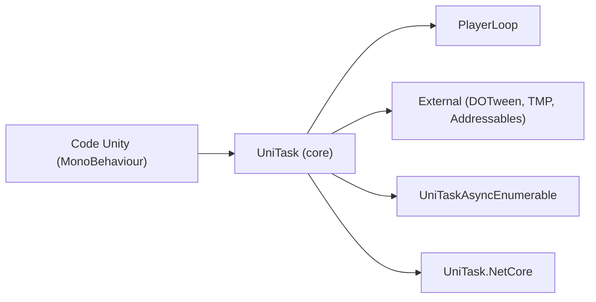

# Cysharp/UniTask

> Async/await sans allocation pour Unity, fondé sur le PlayerLoop.

## Le problème
`Task` est lourd et mal adapté au thread unique de Unity ; les coroutines manquent d'outils (WhenAll, annulation propre).

## Ce que ça fait vraiment
Type `UniTask` basé sur des structs et un AsyncMethodBuilder dédié, qui rend attendables AsyncOperation, coroutines et requêtes web, sans thread ni SynchronizationContext. Fournit LINQ asynchrone, Channel, AsyncReactiveProperty, annulation, timeouts, fenêtre TaskTracker pour repérer les fuites. Support DOTween, TextMeshPro, Addressables ; version .NET Core réduite.

## Comment c'est branché


## Essayer
```bash
dotnet add package UniTask
```
(NuGet pour .NET Core ; pour Unity, ajouter l'URL git du Package Manager indiquée dans le README.)

## Coût et pièges
Gratuit. Un `UniTask` ne peut pas être attendu deux fois. L'import du paquet Entities réinitialise le PlayerLoop : à réinitialiser à la main. Le README ici comporte des extraits de code coupés.

## Ce que ce n'est pas
Pas un outil général : réservé à Unity (ou à du partage de code avec .NET). Sous Unity 6, `Awaitable` couvre le strict minimum.

## Alternatives
- `Awaitable` (Unity 6) : intégré, sans WhenAll ni DelayFrame.

## Pour toi
À ignorer : utile seulement pour du développement Unity/C#, hors data/IA.

