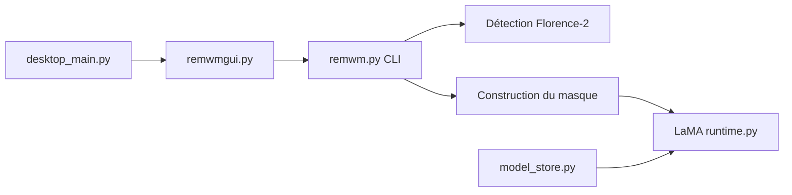

# D-Ogi/WatermarkRemover-AI

> Application that detects watermarks with Florence-2 and erases them with LaMA inpainting, on images and videos.

## The problem
Removing a watermark by hand, image by image, is slow, especially on videos.

## What it actually does
Florence-2 locates the watermark (editable "watermark" prompt), a mask is built, then LaMA fills in the area. Handles images and videos (detection on one frame out of N, mask expansion for fades, audio kept via FFmpeg), batch processing, preview. PyWebview GUI or `remwm.py` CLI. Models are prepared and checked on first launch.

## How it is wired


## Trying it
```bash
git clone https://github.com/D-Ogi/WatermarkRemover-AI.git
cd WatermarkRemover-AI
./setup.sh
./run.sh
python remwm.py input.png output_folder/
```

## Cost and gotchas
Python 3.10+ (Linux/macOS), CUDA GPU to speed things up, FFmpeg to keep the audio. Models are downloaded on first launch.

## What it is not
Not a neutral tool: the README targets AI-generated videos (Sora, Runway) and does not address copyright or the terms of use of the works concerned. Quality on complex watermarks is not quantified.

## Alternatives
No alternative named in the README.

## For you
Ignore: one-off media retouching, of no interest for a data/AI pipeline, and with rights questions you would have to settle yourself.
