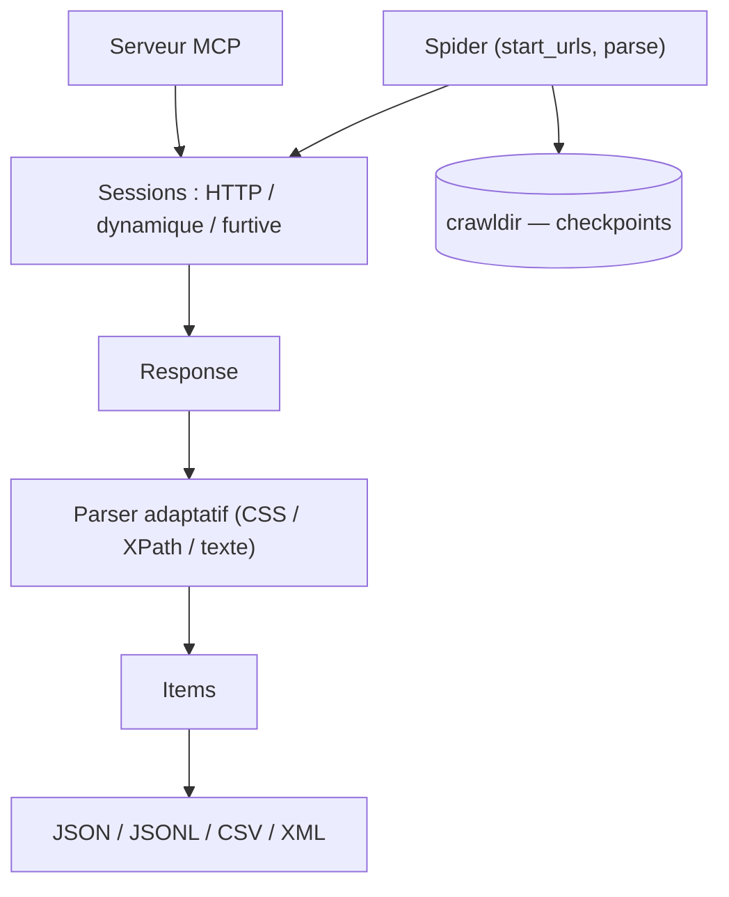

# D4Vinci/Scrapling

> Python scraping framework that includes a parser that can identify elements even after a website change.

## The problem
A CSS selector breaks as soon as the website changes its structure, and the scraper needs to be rewritten.
Anti-bot protections block requests before they even reach the content.

## What it actually does
With `auto_save=True` and `adaptive=True`, the parser relocates elements based on similarity after a change.

Three fetchers: HTTP with simulated TLS, a full browser, and a stealth mode that bypasses Cloudflare Turnstile.
A spider framework similar to Scrapy: concurrency, domain-level throttling, pause/resume by checkpoint, streaming.
Ready-made templates: `CrawlSpider`, `SitemapSpider`, `XMLFeedSpider`, `CSVFeedSpider`, `ShopifySpider`, `SiteToMarkdownSpider`.
An MCP server that exposes scraping to agents, with prompt injection cleaning before reading.

## How it is wired


## Trying it
```bash
pip install "scrapling[fetchers]"
scrapling install
scrapling shell
scrapling extract get 'https://example.com' content.md
```

## Cost and gotchas
Free. Requires Python 3.10+. The `pip install scrapling` command only installs the parser; importing a fetcher will fail.
The extractors (`fetchers`, `ai`, `rag`, `shell`, `all`) are then added, and you still need to run `scrapling install` to install the browsers.

## What it is not
Not a guaranteed workaround: the README reminds users that usage must comply with the terms and conditions and the robots.txt file.
The performance benchmarks mentioned are produced by the project itself (`benchmarks.py`).
No agent: the LLM is not present in the crawling loop, except through the MCP server.

## Alternatives
- `unclecode/crawl4ai`: more focused on "page-to-Markdown" than on large-scale, structured crawling.
- `browser-use/browser-use`: when the browsing decision should be made by a model.

## For you
The adaptive parser is the key: it reduces the maintenance required for scrapers. It should be tested on a website that is prone to instability.
