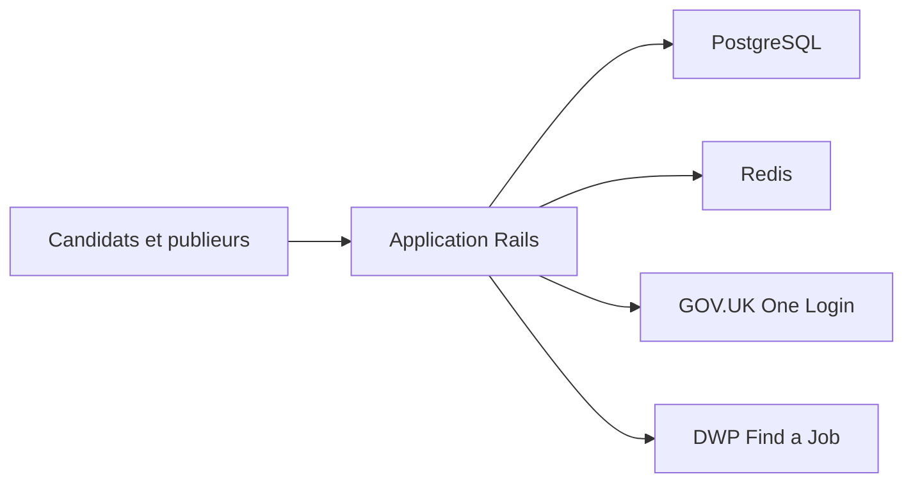

# DFE-Digital/teaching-vacancies

> British public-sector job board for teachers: Rails code and infrastructure of the official site.

## The problem
Teachers in England need to search for posts in schools and trusts, save listings and receive alerts.

## What it actually does
The repository contains the code and infrastructure definition of the service: a Ruby on Rails application with PostgreSQL and Redis. The README is a table of contents pointing to the documentation: onboarding, deployment, Terraform, monitoring, integrations (DWP Find a Job, API for ATS), GOV.UK One Login sign-in.

## How it is wired
Simplified diagram based on the fiche, no diagram provided.



## Trying it
```bash
# Aucune commande dans le README : il renvoie à la page "Developers quick start".
```

## Cost and gotchas
No installation procedure in the README, which targets internal teams (onboarding, AWS roles). The service depends on AWS infrastructure and British government services.

## What it is not
It is not a reusable product or a library: it is the code of one specific service. The README gives neither a getting-started guide nor use cases outside this service.

## Alternatives
No alternative named in the README.

## For you
Ignore: a ministry's Rails business application, with no reuse on the data / AI side; only the operations documentation may be inspiring.
