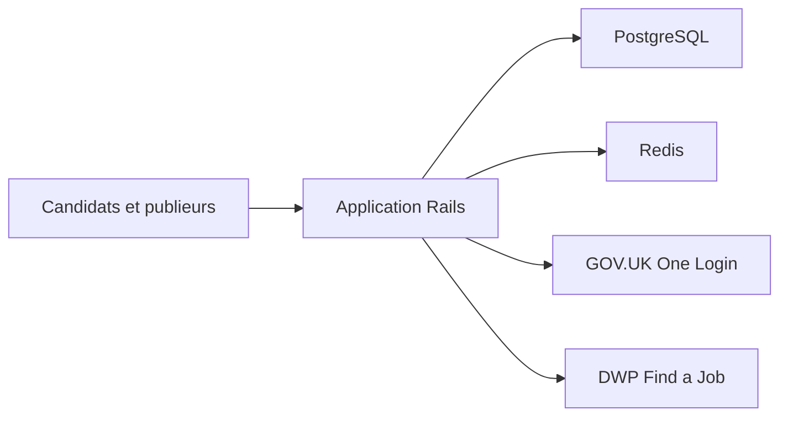

# DFE-Digital/teaching-vacancies

> Service public britannique d'offres d'emploi pour enseignants : code Rails et infrastructure du site officiel.

## Le problème
Les enseignants d'Angleterre doivent chercher des postes dans des écoles et trusts, enregistrer des offres et recevoir des alertes.

## Ce que ça fait vraiment
Le dépôt contient le code et la définition d'infrastructure du service : une application Ruby on Rails avec PostgreSQL et Redis. Le README est un sommaire vers la documentation : onboarding, déploiement, Terraform, supervision, intégrations (DWP Find a Job, API pour ATS), connexion GOV.UK One Login.

## Comment c'est branché
Schéma simplifié d'après la fiche, sans diagramme fourni.



## Essayer
```bash
# Aucune commande dans le README : il renvoie à la page "Developers quick start".
```

## Coût et pièges
Pas de procédure d'installation dans le README, qui vise des équipes internes (onboarding, rôles AWS). Le service dépend d'une infrastructure AWS et de services de l'administration britannique.

## Ce que ce n'est pas
Ce n'est pas un produit réutilisable ni une bibliothèque : c'est le code d'un service précis. Le README ne donne ni démarrage ni cas d'usage hors de ce service.

## Alternatives
Aucune alternative nommée dans le README.

## Pour toi
À ignorer : application métier Rails d'un ministère, sans réutilisation côté data / IA ; seule la documentation d'exploitation peut inspirer.

