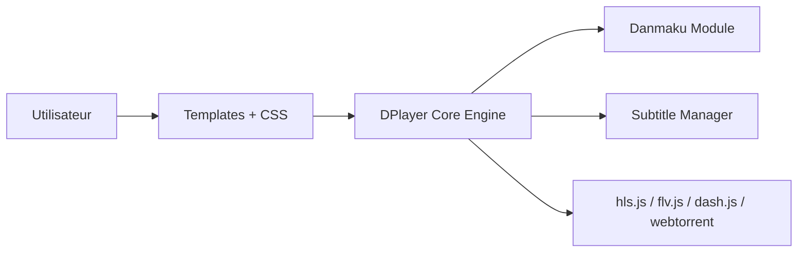

# DIYgod/DPlayer

> HTML5 video player with danmaku (scrolling comments), for websites and applications.

## The problem
Showing streaming video with overlaid comments requires assembling a player, subtitles and streams.

## What it actually does
An HTML5 player handling HLS, FLV, MPEG-DASH, WebTorrent, MP4, WebM and Ogg, with danmaku, screenshots, shortcuts, quality switching, thumbnails and subtitles. The README lists many related projects: danmaku APIs (Node, PHP, Ruby), WordPress, Hexo, Vue and React plugins.

## How it is wired

## Trying it
No command in the README: it points to the external documentation.

## Cost and gotchas
Free. For danmaku, a separate backend is needed (third-party projects listed). Last push in March 2026; 268 open issues.

## What it is not
Not a streaming service: it provides neither encoding nor hosting. The README is mostly a directory of related projects and users, not a usage guide.

## Alternatives
DPlayer-Lite (lightweight version) and CBPlayer (with the CDNBye P2P plugin), both cited in the README.

## For you
Ignore: a web video player unrelated to data/AI/MLOps work.
