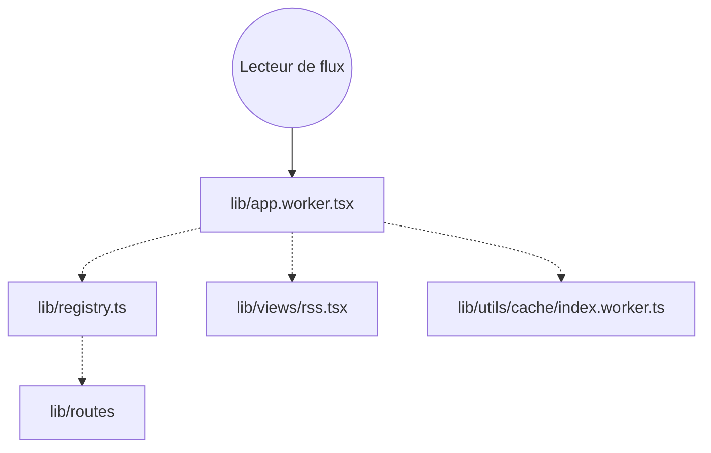

# DIYgod/RSSHub

> RSS feed generator for websites that don't already have one, suitable for self-hosting or public use.

## The problem
Many websites and social media platforms do not offer RSS feeds, so they cannot be followed in an RSS reader.

## What it actually does
A service receives a feed request, chooses a route (`lib/routes`), retrieves the content from the source, and returns an RSS or Atom feed. It includes caching, middleware, error handling, API integration, and a worker entry point. The README mentions over 5,000 instances. The routes and wiring have not been examined, hence the dotted lines.

## How it is wired

## Trying it
There are no commands in the README: it directs users to the deployment documentation and the Quick Start guide.

## Cost and gotchas
Free. Self-hosting requires managing broken links when a website changes. A "one-click" link goes through Hostinger, a paid hosting provider.

## What it is not
Not an RSS reader (Folo, for example, is one). No guarantee of road availability. AGPL-3.0 license.

## Alternatives
RSSHub Radar (an extension for discovering feeds), Folo (a reader). These two projects complement RSSHub rather than replacing it.

## For you
Useful for powering a continuous feed of content (blogs, repositories, social networks): use it in a self-hosted configuration, keeping the AGPL license in mind.
