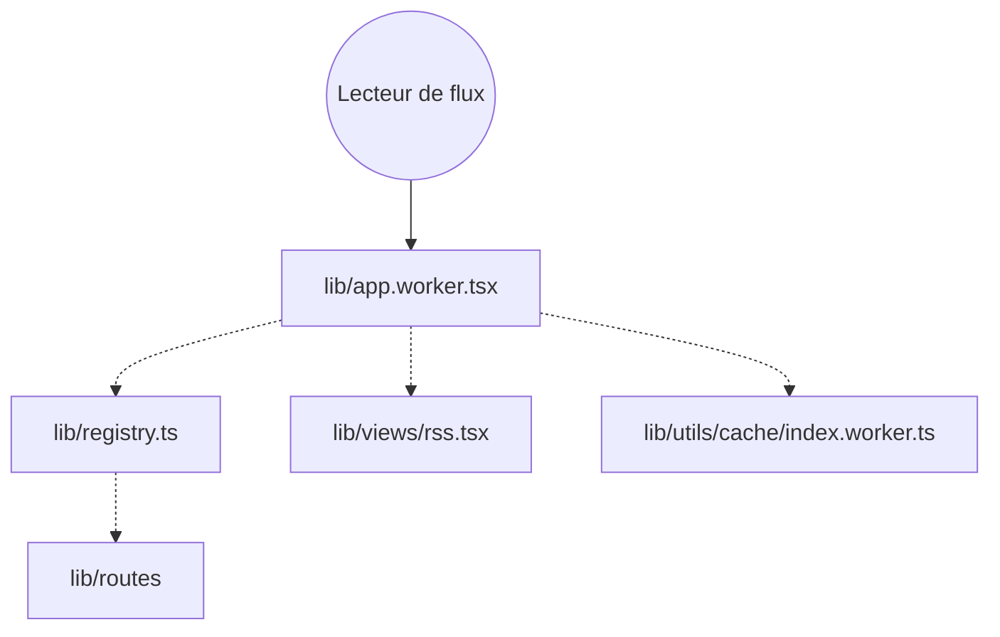

# DIYgod/RSSHub

> Générateur de flux RSS pour des sites qui n'en publient pas, à auto-héberger ou à utiliser en instance publique.

## Le problème
Beaucoup de sites et de réseaux sociaux n'offrent pas de flux RSS, donc on ne peut pas les suivre dans un lecteur.

## Ce que ça fait vraiment
Un service reçoit une requête de flux, choisit une route (`lib/routes`), récupère le contenu de la source et renvoie un flux RSS ou Atom. Il comprend cache, middleware, gestion d'erreurs, API et point d'entrée worker. Le README parle de plus de 5 000 instances. Les routes et le câblage n'ont pas été examinés, d'où les liens en pointillés.

## Comment c'est branché

## Essayer
Aucune commande dans le README : il renvoie vers la documentation de déploiement et le Quick Start.

## Coût et pièges
Gratuit. L'auto-hébergement impose de gérer les routes cassées quand un site change. Un lien « un clic » passe par Hostinger, un hébergeur payant.

## Ce que ce n'est pas
Pas un lecteur RSS (Folo, cité, en est un). Pas une garantie de disponibilité des routes. Licence AGPL-3.0.

## Alternatives
RSSHub Radar (extension pour découvrir des flux), Folo (lecteur). Ces deux projets complètent RSSHub plus qu'ils ne le remplacent.

## Pour toi
Utile pour alimenter une veille automatisée en flux (blogs, dépôts, réseaux) : adopte-le en auto-hébergé, en gardant l'AGPL en tête.

