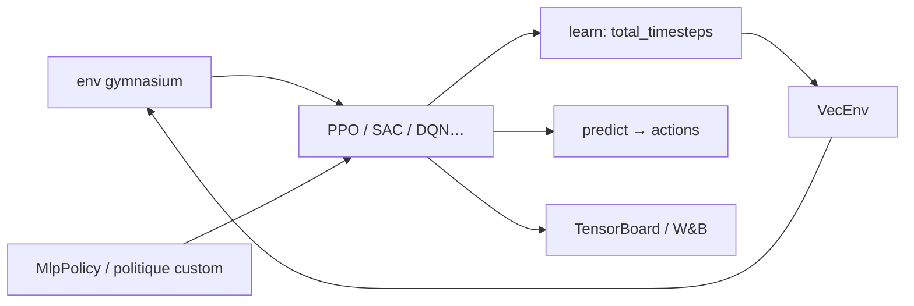

# DLR-RM/stable-baselines3

> Reliable implementations of reinforcement learning algorithms in PyTorch.

## The problem
Published RL implementations are often not reproducible: the same algorithm gives very
different results depending on implementation details.

## What it actually does
SB3 provides A2C, DDPG, DQN, HER, PPO, SAC and TD3 in PyTorch, with a common scikit-learn-style
interface (`model.learn(total_timesteps=...)`, `model.predict(obs)`). The performance of each
algorithm has been tested and published. Handles custom environments and policies, `Dict` observation
spaces, callbacks, TensorBoard, type annotations and high test coverage.
Weights & Biases and Hugging Face integrations.

## How it is wired


## Trying it
```bash
pip install 'stable-baselines3[extra]'
pip install -e '.[docs,tests,extra]'
make pytest
make type
make lint
```

## Cost and gotchas
Free. Python 3.10+ and PyTorch >= 2.8. The `[extra]` extra pulls in TensorBoard, OpenCV, `ale-py`,
pandas and matplotlib. The maintainers state that they provide no technical support or
consulting and do not answer questions by email.

## What it is not
Not an entry point into RL: the README warns that you must already know the field.
The project is declared *stable*, development focuses on fixes and maintenance; new
algorithms go into SB3-Contrib, fast variants into SBX. Nor is it a complete training
framework — that is the role of the RL Zoo.

## Alternatives
- SB3-Contrib: Recurrent PPO, CrossQ, TQC, QR-DQN, Maskable PPO, more recent algorithms.
- SBX (SB3 + Jax): up to 20× faster, but fewer features.
- RL Baselines3 Zoo: training scripts, hyperparameter tuning and tuned configurations.

## For you
The reference baseline when you need to honestly compare a home-grown RL approach to an
established algorithm — and the Zoo saves you from hunting for hyperparameters.
